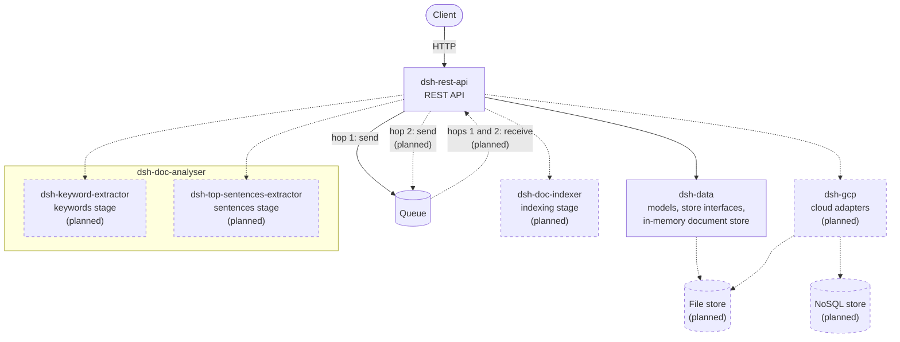

# Architecture

DSH is sorted here by the three patterns of Pivotal Labs'
["Agile Architecture"](https://blogs.vmware.com/tanzu/agile-architecture/) (2017), which follows
Robert Martin: Request/Response, Event Driven and Batch. The article prescribes no diagrams; the
ones below are DSH's own.

## Request/Response

A user asks and waits for the reply, and retrying is the user's job.

In DSH this is the REST API, under `/v1/dsh/document`:

- `POST /submit` takes a document and returns a token.
- `GET /status/{token}` returns the processing status of the document the token was issued for.

The user polls the status. A failed call is the caller's to repeat. Retrieving the results is not
available yet.

## Event Driven

Actors react to events, and may produce new ones.

In DSH this is the pipeline that processes a document after `/submit`, drawn on [Home](Home). Each
stage reacts to a message on a queue that carries the document's id and nothing else, and its
result moves the document to its next status. A message is delivered at least once, and delivered
again when a store cannot be reached, so a stage must be safe to run twice. A stage's own failure
is recorded, and is final. Only the first step exists today: `/submit` puts the id on the first
queue, and nothing receives it yet.

## Batch

The system works on its own schedule, so detecting failures, retrying and recovering are its job.

DSH has no Batch part today, and none is planned. Every piece of work it does starts from a
request or from a message.

## Components

- **Built.** `dsh-rest-api` is the one application: the REST API today, and the pipeline once it
  is built. `dsh-data` holds the models, the interfaces of the stores, and the document store DSH
  runs with by default, which keeps documents in memory. The queue carries a document's id from
  `/submit` to the pipeline: today `dsh-rest-api` sends it on hop 1, and nothing receives it.
- **Planned.** Each stage drawn on [Home](Home) is a library module: indexing is
  `dsh-doc-indexer`, keywords `dsh-keyword-extractor`, and sentences
  `dsh-top-sentences-extractor`. The modules exist and hold no code yet. A stage never touches the
  queue: the pipeline in `dsh-rest-api` receives a document's id from a hop, calls the stage, and
  sends the id on the next hop, which is why every edge to and from the queue is
  `dsh-rest-api`'s. The file store will hold the document and whatever grows with it: by default
  a local directory, through an implementation in `dsh-data`. `dsh-gcp` will hold the adapters to
  a cloud provider's NoSQL store, file store and queue: with them, the application reaches the
  hops through that adapter, and the NoSQL store holds each document's record.
- The modules that hold only test fixtures or build reports are not drawn.

## The decisions behind it

- [ADR-001](https://github.com/MRISS-Projects/dsh/blob/DEVELOP/specs/architecture/ADR-001-GCP-based-components.md):
  the managed services DSH moves to.
- [ADR-003](https://github.com/MRISS-Projects/dsh/blob/DEVELOP/specs/architecture/ADR-003-document-pipeline.md):
  the pipeline, its modules, and how an implementation is selected.
- [ADR-004](https://github.com/MRISS-Projects/dsh/blob/DEVELOP/specs/architecture/ADR-004-gcp-tiers.md):
  the tiers DSH runs in.
- [System design](https://github.com/MRISS-Projects/dsh/blob/DEVELOP/specs/architecture/system-design.md):
  today's architecture in detail.
