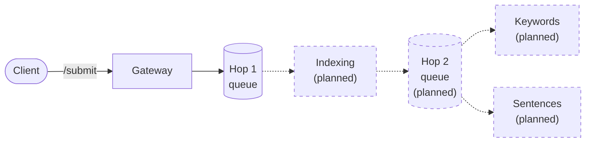

# Document Smart Highlights

Document Smart Highlights (DSH) aims to provide web services that accept PDF and HTML files and
return a list of keywords and the most relevant sentences, extracted with NLP techniques; the
sentences through automatic document summarization.

## What DSH does today

DSH accepts a PDF document, keeps it in a document store, in memory by default, puts the
document's id on a queue for indexing, and reports the document's processing status. Nothing takes
the id off that queue yet, so DSH does not index documents and does not extract keywords or
sentences. The REST API has two operations: submit a document and receive a token, and ask for the
status of the document a token was issued for.

## The pipeline

A document passes six steps: the gateway, two hops and three stages. The gateway is the API's `/submit`: it stores the document and
sends its id on hop 1. A message carries the document's id and nothing else, and each stage reads
what it needs from the stores. The parts marked planned, with a dashed outline, have no code yet:
today nothing receives from hop 1.

The diagram is drawn by hand from section 1 of
[ADR-003](https://github.com/MRISS-Projects/dsh/blob/DEVELOP/specs/architecture/ADR-003-document-pipeline.md),
which decides the pipeline. Once the pipeline's code exists, the diagram will be generated from it.
[Architecture](Architecture) shows the modules and the systems they use.

## Planned processing

### File submission

1. The user submits a file with a web service call. DSH accepts it for asynchronous processing and
   returns a token.
2. The user asks for the processing status with the token, as often as needed.
3. When processing is done, the user retrieves the results with another call, in two parts:
   - a list of keywords
   - a list of the most relevant sentences

   Retrieving the results is not available yet.

### File indexing

The indexing stage extracts the document's text and identifies its individual terms, inside the
application. It stores the result, and updates the statistics of every term across all documents,
which keyword scoring needs.

### Keyword extraction

1. Each term in the document's text is scored with a
   [TF/IDF](https://en.wikipedia.org/wiki/Tf%E2%80%93idf) approach, through several implementations
   of TF and IDF, as shown in [this paper](https://doi.org/10.2352/issn.2168-3204.2017.1.0.105).
2. The terms with the best scores, obtained by a
   [meta-algorithmic](https://www.amazon.com/Meta-Algorithmics-Patterns-Robust-Quality-Systems/dp/1118343360)
   combination of all the TF/IDF combinations, are returned as the best ranked keywords.

### Most relevant sentences

1. Typical [automatic summarization](https://en.wikipedia.org/wiki/Automatic_summarization)
   techniques are applied, such as extractive summarization or
   [keyphrase extraction](https://en.wikipedia.org/wiki/Automatic_summarization#Keyphrase_extraction).
2. A sentence's relevance takes two criteria into account:
   - its similarity to the title, using the algorithm of
     [this paper](https://doi.org/10.1016/j.csl.2016.01.003);
   - combinations of the TF/IDF of each of its terms, using the keyword extraction above.
3. The sum of the two criteria is the sentence's score. The best scored sentences are returned with
   their paragraph numbers.

## More

- [Architecture](Architecture): the patterns DSH follows, and its components.
- [Developers](Developers): where to start working on DSH.
- [Workflow](Workflow): the statuses a document moves through.
- [Code Based Site and Reports](Code-Based-Site-and-Reports): the Maven sites and their reports.
