# Spring Integration

DSH's document pipeline is built on Spring Integration. This page is a map of how: the one flow,
its gateway and its two hops, where the stages and the status recorder attach, and what joins a
hop's two channels under each transport. It decides nothing. Every decision on it is
[ADR-003](https://github.com/MRISS-Projects/dsh/blob/DEVELOP/specs/architecture/ADR-003-document-pipeline.md)'s,
and each section links to the part of the ADR that makes it. Where this page and the ADR differ,
the ADR is right.

## Today

On `DEVELOP` at `82c8d184b`, on 2026-11-17, none of the flow below is built. Spring Integration is
in `dsh-rest-api`, wired in XML, and does one thing: it sends a document's id to RabbitMQ.

- `dsh-rest-api`'s POM declares `spring-boot-starter-integration`, `spring-integration-amqp` and
  `spring-integration-stream`.
- `DshRestApplication` imports `enqueue-docId-context.xml` with `@ImportResource`. The context
  declares a channel, `toRabbit`, and an AMQP outbound channel adapter on it, which publishes to
  RabbitMQ with publisher confirms. The confirms come back on a second channel,
  `toRabbitResponse`.
- `DocumentQueueServiceImpl` sends the id on `toRabbit`. It runs on an `@Async` thread, which
  `/submit` starts and does not wait for.
- Nothing receives the id. `dequeue-docId-context.xml`, a test resource that only logs what it
  receives, is referenced by nothing.

Wave 2 task 1 deletes the enqueue path: the context, `DocumentQueueServiceImpl` and its handlers,
the AMQP dependencies, and the unused `dequeue-docId-context.xml`
([ADR-003, section 7](https://github.com/MRISS-Projects/dsh/blob/DEVELOP/specs/architecture/ADR-003-document-pipeline.md#7-the-xml-contexts);
[the PRD's Wave 2](https://github.com/MRISS-Projects/dsh/blob/DEVELOP/specs/product/PRD.md#wave-2--pipeline-walking-skeleton)).
It builds the flow below in their place. All new wiring is Java configuration.

## The flow

The pipeline is one `IntegrationFlow`, written with the Java DSL, in `dsh-rest-api`
([ADR-003, section 1](https://github.com/MRISS-Projects/dsh/blob/DEVELOP/specs/architecture/ADR-003-document-pipeline.md#1-the-flow)).
In order:

1. **A gateway.** `/submit` stores the document as `CREATED` and hands its id to the flow here.
   It answers with the token once point 2, the outcome of hop 1's send, is recorded
   ([`/submit`](https://github.com/MRISS-Projects/dsh/blob/DEVELOP/specs/architecture/ADR-003-document-pipeline.md#submit)).
2. **Hop 1**, asynchronous.
3. **The indexing stage.**
4. **Hop 2**, asynchronous.
5. **The keywords stage.**
6. **The sentences stage**, straight after the keywords stage, with no hop between them.

A message carries the document's id and nothing else. A stage reads what it needs from the
document store and the file store, and its result is written back to them
([what each step reads and writes](https://github.com/MRISS-Projects/dsh/blob/DEVELOP/specs/architecture/ADR-003-document-pipeline.md#what-each-step-reads-and-writes)).

A stage is a plain Java class in a library module: the indexing stage in `dsh-doc-indexer`, the
keywords stage in `dsh-keyword-extractor`, the sentences stage in `dsh-top-sentences-extractor`
([a stage](https://github.com/MRISS-Projects/dsh/blob/DEVELOP/specs/architecture/ADR-003-document-pipeline.md#a-stage);
[the modules](https://github.com/MRISS-Projects/dsh/blob/DEVELOP/specs/architecture/ADR-003-document-pipeline.md#the-modules)).
It imports nothing from Spring Integration, never writes a status, and reports a failure by
throwing. The flow calls it. A stage knows nothing of channels, hops or transports.

## The status recorder

One component in `dsh-rest-api` records every change of status
([the status recorder](https://github.com/MRISS-Projects/dsh/blob/DEVELOP/specs/architecture/ADR-003-document-pipeline.md#the-status-recorder)).
It attaches at two kinds of point:

- **Around every stage**, as an advice: where the stage starts, and where it ends in success or
  in error.
- **On each hop's channel**, as an interceptor: where the id is sent, where the outcome of the
  send is known, and where the id is received.

That these two kinds of attachment see all twelve points is assumption A1, which Wave 2 task 1
proves
([assumptions](https://github.com/MRISS-Projects/dsh/blob/DEVELOP/specs/architecture/ADR-003-document-pipeline.md#assumptions)).

The recorder never names the status a document moves to. It applies a `TransitionType`,
`NEUTRAL`, `SUCCESS` or `ERROR`, and `DocumentStatus.transition` picks the next status. What the
recorder does know is the status each point expects to find, because it advances by
compare-and-set: an advance applies only if the stored status is still the expected one
([compare-and-set](https://github.com/MRISS-Projects/dsh/blob/DEVELOP/specs/architecture/ADR-003-document-pipeline.md#compare-and-set)).
The twelve points, with what each applies, expects and leads to, are in
[ADR-003's table](https://github.com/MRISS-Projects/dsh/blob/DEVELOP/specs/architecture/ADR-003-document-pipeline.md#the-status-recorder),
which this page does not copy.

## The hops

A hop is two `MessageChannel`s that the flow names: one the id is sent on, and one it is received
from. `MessageChannel` is the transport's interface. DSH puts no interface of its own in front of
it, because the flow is the channel's only consumer
([the interfaces](https://github.com/MRISS-Projects/dsh/blob/DEVELOP/specs/architecture/ADR-003-document-pipeline.md#the-interfaces)).

What joins the two channels is selected by `dsh.transport`
([section 3](https://github.com/MRISS-Projects/dsh/blob/DEVELOP/specs/architecture/ADR-003-document-pipeline.md#3-selecting-an-implementation);
[the hops, by transport](https://github.com/MRISS-Projects/dsh/blob/DEVELOP/specs/architecture/ADR-003-document-pipeline.md#the-hops-by-transport)):

- **With no profile**, `dsh.transport` is `memory`, and an executor in the JVM joins the two
  channels. The send hands the id to the executor, and the executor's thread carries it on.
- **Under the `gcp` profile**, `dsh.transport` is `pubsub`, and each hop is a Pub/Sub topic with
  a push subscription to the same Cloud Run service. The send publishes the id to the hop's topic
  and waits for the outcome, which the recorder needs inside the request that published; that it
  is known there is assumption A2. Pub/Sub then posts the id over HTTP to an endpoint of the
  service, which reads it from the request and hands it to the flow. The code for both lives in
  `dsh-gcp`, a module that is new in Wave 5 and gains the Pub/Sub side of the hops in Wave 6. No
  other module can compile against a Pub/Sub type
  ([how the build checks rules 1 and 2](https://github.com/MRISS-Projects/dsh/blob/DEVELOP/specs/architecture/ADR-003-document-pipeline.md#how-the-build-checks-rules-1-and-2)).

### Why not Spring Cloud GCP's inbound channel adapter

Spring Cloud GCP has an inbound channel adapter for Pub/Sub, and the flow does not use it. The
adapter receives by streaming pull, and a subscriber that pulls needs an instance alive to poll.
That breaks DSH's
[cost rule](https://github.com/MRISS-Projects/dsh/blob/DEVELOP/CLAUDE.md#cost-rule-for-gcp):
Cloud Run's minimum instances is 0, always. A push subscription needs no instance waiting. Each
message arrives as a request of its own, and CPU is allocated while that request runs
([section 4](https://github.com/MRISS-Projects/dsh/blob/DEVELOP/specs/architecture/ADR-003-document-pipeline.md#4-the-gcp-transport)).

The three requests a submission makes under `gcp`, the client's and one per hop, are drawn in
ADR-003's
[request sequence](https://github.com/MRISS-Projects/dsh/blob/DEVELOP/specs/architecture/ADR-003-document-pipeline.md#the-request-sequence-under-gcp).
Its endpoint paths and topic names are placeholders, which Wave 6 fixes.

## The flow, drawn

This diagram is drawn by hand from ADR-003 sections 1 and 4, because no flow exists yet to
generate it from. Wave 2 task 5 replaces it with a diagram generated from the running flow.

```mermaid
flowchart LR
    submit["POST /submit"] -.-> gateway["gateway<br/>(planned)"]
    gateway -.-> send1
    subgraph hop1["hop 1 (planned)"]
        send1["send channel<br/>(planned)"] -.-> join1["executor, or under gcp<br/>a Pub/Sub topic and push endpoint<br/>(planned)"]
        join1 -.-> recv1["receive channel<br/>(planned)"]
    end
    recv1 -.-> indexing["indexing stage<br/>dsh-doc-indexer<br/>(planned)"]
    indexing -.-> send2
    subgraph hop2["hop 2 (planned)"]
        send2["send channel<br/>(planned)"] -.-> join2["executor, or under gcp<br/>a Pub/Sub topic and push endpoint<br/>(planned)"]
        join2 -.-> recv2["receive channel<br/>(planned)"]
    end
    recv2 -.-> keywords["keywords stage<br/>dsh-keyword-extractor<br/>(planned)"]
    keywords -.-> sentences["sentences stage<br/>dsh-top-sentences-extractor<br/>(planned)"]
    recorder["status recorder<br/>(planned)"]
    recorder -.->|"interceptor: points 1 to 3"| hop1
    recorder -.->|"advice: points 4 and 5"| indexing
    recorder -.->|"interceptor: points 6 to 8"| hop2
    recorder -.->|"advice: points 9 and 10"| keywords
    recorder -.->|"advice: points 11 and 12"| sentences
    classDef planned stroke-dasharray: 5 5
    class gateway,send1,join1,recv1,indexing,send2,join2,recv2,keywords,sentences,recorder planned
    style hop1 stroke-dasharray: 5 5
    style hop2 stroke-dasharray: 5 5
```

- **Built.** Only `POST /submit`. Today it sends the id to RabbitMQ, as "Today" says above, and
  not to a gateway. Home still draws the gateway and hop 1 as built, and Architecture hop 1's
  send, until Wave 2 task 1 corrects them.
- **The points** are the twelve of
  [ADR-003's table](https://github.com/MRISS-Projects/dsh/blob/DEVELOP/specs/architecture/ADR-003-document-pipeline.md#the-status-recorder).
  The recorder's edge to a hop goes to the whole hop, because ADR-003 does not say which of its
  two channels carries each point.

## More

- [Workflow](Workflow): the statuses a document moves through, which the recorder advances.
- [Architecture](Architecture): the modules, and where the flow sits among them.
- ADR-003:
  [section 1, the flow](https://github.com/MRISS-Projects/dsh/blob/DEVELOP/specs/architecture/ADR-003-document-pipeline.md#1-the-flow);
  [section 3, selecting an implementation](https://github.com/MRISS-Projects/dsh/blob/DEVELOP/specs/architecture/ADR-003-document-pipeline.md#3-selecting-an-implementation);
  [section 4, the `gcp` transport](https://github.com/MRISS-Projects/dsh/blob/DEVELOP/specs/architecture/ADR-003-document-pipeline.md#4-the-gcp-transport);
  [section 7, the XML contexts](https://github.com/MRISS-Projects/dsh/blob/DEVELOP/specs/architecture/ADR-003-document-pipeline.md#7-the-xml-contexts).
