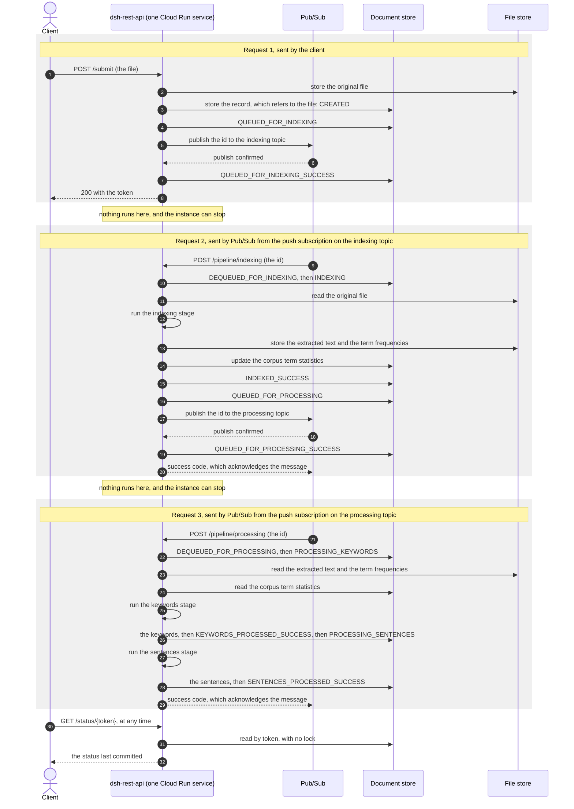

# ADR-003: The Document Pipeline

| Field       | Value                        |
|-------------|------------------------------|
| **Date**    | 2026-10-13                   |
| **Status**  | Accepted                     |
| **Authors** | Backend Development Team     |

The owner's merge of the pull request that adds this file is the acceptance.

---

## Context

DSH does not process documents yet. This ADR decides how the pipeline that will process them is
structured: its flow, its deployables, its transports, how an implementation is selected, and
where corpus statistics live. [ADR-001](./ADR-001-GCP-based-components.md) stays the record of why
DSH moves to GCP and onto which services, and is revised to match this one.

"The findings" means [`profiles-and-configuration.md`](./profiles-and-configuration.md), the
output of `#48`. Its probe ids (P0 to P31), finding ids (S1 to S8, M1 to M4), rule ids (R1 to R12)
and GCP fact ids (G1 to G8) are used here as they are there. Facts read for this ADR are F1 to
F12, and assumptions are A1 to A6; both are listed under [Evidence](#evidence) and
[Assumptions](#assumptions).

Wave and task numbers are those of the re-plan of 2026-10-10 in `specs/product/PRD.md`. A later
re-plan will move them.

### What exists today

On `DEVELOP` at `043adc533`, on 2026-10-12.

| Fact | Evidence |
|---|---|
| Nothing consumes the queue. `dsh-rest-api` stores a document and sends its id to RabbitMQ, and no module reads it | `DocumentSubmissionServiceImpl`, `DocumentQueueServiceImpl`; no `inbound` adapter in any module |
| The four worker modules each hold one `Application` class and nothing else | `git ls-files '*/src/main/java/*.java'`: `DshDocIndexerApplication`, `DshDocProcessorWorkerApplication`, `DshKeywordExtractorApplication`, `DshTopSentencesExtractorApplication` |
| `dsh-doc-processor-worker` depends on the two extractor modules. Its only purpose was to run one after the other | `dsh-doc-analyser/dsh-doc-processor-worker/pom.xml` |
| `/submit` returns the token first. The document is stored and enqueued afterwards, on an `@Async` thread | `DocumentSubmissionServiceImpl.storeDocumentAndQueueForProcessing` |
| A document is never stored as `CREATED`. The first store happens after one `NEUTRAL` transition, so the first stored status is `QUEUED_FOR_INDEXING` | the same method |
| Status is written by saving the whole `Document`. There is no update of the status alone, and no conditional update | `DocumentDao` has `storeDocument`, three finders and `clearDocuments` |
| `DocumentStatus` has 18 states and models two queues: one before indexing and one before processing. Keywords and sentences run back to back with no queue between them | `DocumentStatus`; `specs/architecture/document-status-workflow.md` |
| `DocumentDao` names no technology. Only `DocumentRepository`, below it, extends `MongoRepository` | `dsh-data/…/document/dao/DocumentDao.java`, `…/mongo/DocumentRepository.java` |
| Solr is not used by any code. `IndexedDocumentDao` and `SOLRIndexedDocument` are empty, and the two plugins in `dsh-solr` are called by nothing | the two files; a grep for `solr` over every `*.java` outside `dsh-solr` |
| The API has `/submit` and `/status/{token}`. It has no search endpoint and no `order` parameter | `DocumentResource` |
| `dequeue-docId-context.xml` exists only as a test resource of `dsh-rest-api`. Nothing references it, and it does nothing but log what it receives | `dsh-rest-api/src/test/resources/dequeue-docId-context.xml`; a grep for its name over every `*.java`, `*.xml`, `*.properties` and `*.yml` finds no reference |
| The original file is held inside the record, as `byte[] originalFileContents`. Moving it to a file store is already planned, and is not a decision of this ADR | `Document.java`; ADR-001 §3.1; PRD Wave 1 task 10 |
| `AdvancedNumberFilter` imports Lucene's analysis classes and nothing of Solr. The vector-order plugin imports Solr | the imports of the classes under `dsh-solr/*/src/main/java` |
| `NOT_INDEXED_ERROR` carries the description and message of `DEQUEUED_FOR_INDEXING` | `DocumentStatus.java`, the constant's constructor arguments |

Until this ADR revised it, ADR-001 planned a migration of consumers that were never written. Its
Context table said the workers dequeued and processed documents, and it treated
`dequeue-docId-context.xml` as production configuration to convert.

### Inputs

These were decided before this ADR, and it does not reopen them.

- **The owner's decisions of 2026-09-28** (PRD §4). The pipeline is built on the new interfaces,
  and nothing new is built on RabbitMQ or Solr. The flow is Spring Integration's Java DSL, with
  stages as plain Java classes. Maven Central is ruled out. Algorithms come before GCP.
- **The owner's decisions of 2026-10-10** (PRD §4). The operated tiers, and the `0.6.0` milestone.
- **The cost rule** in `CLAUDE.md`. Cloud Run's minimum instances is 0, always.

Three proposals reached this ADR as proposals. The PRD proposed one `IntegrationFlow` with one
place that records status. The findings proposed a property per service with `gcp` as the profile
that sets them together (R3), Pub/Sub by push (findings §8.4), and the XML contexts under a
profile where they stand (S5). Sections 1, 3, 4 and 7 accept, change or reject each.

The decisions below were agreed with the owner on 2026-10-12 and 2026-10-13.

---

## Decision

Nine sections, one for each question the issue asks (`#160`, AC003 to AC011), in that order.

### 1. The flow

**Decision.** The pipeline is one `IntegrationFlow`, defined with the Java DSL in `dsh-rest-api`,
with two asynchronous hops, as `DocumentStatus` already models: submit, hop 1, indexing, hop 2,
then keywords and sentences together. A stage is a plain Java class that never writes a status.
One component, the status recorder, records every transition, and it advances a status by
compare-and-set. Every write of a status is atomic, and every read returns a committed state (on
Firestore: F7, F9, F10 and assumption A3, under "Atomicity" below). Terms are extracted inside the JVM, by a library, in the indexing stage. The indexing stage's
output goes to the file store, and the record in the document store stays bounded.

**Reason.** The two hops are the two queues the 18 states already describe, so the status API does
not change. With one recorder, no stage can leave a document in a status of its own making, and
`DocumentStatus.transition` stays the only definition of where each status leads. Compare-and-set is
what keeps a late write from overwriting newer state when two instances handle one document, and
it is correct only if the comparison and the write are one operation. A later stage can run in
another request, on another instance, so whatever it needs has to be in a store, and Firestore
limits the size of one document (F7).

**Rejected.** Six alternatives.

- **One hop for the whole pipeline.** It removes the four statuses of hop 2 from the status API,
  and makes one request carry the whole document.
- **A hop per stage.** It adds statuses and a topic, for a split nobody has asked for.
- **Atomicity left to each implementation.** That is how a default store that never fails hides a
  defect that appears only on GCP.
- **Choosing the term-extraction library here.** It is a decision about an algorithm's input, and
  belongs with the story that has the fixtures to judge it, Wave 3 task 1.
- **The indexing stage's output in the record.** A long document pushes the record past
  Firestore's limit on the size of a document (F7).
- **The indexing stage's output carried in the message.** The message is the document's id and
  nothing else.

#### The flow at run time

A gateway, hop 1, the indexing stage, hop 2, the keywords stage, the sentences stage. The message
carries the document's id and nothing else. A stage reads what it needs from the stores.

With Solr gone, "indexing" means text extraction and the update of the corpus term statistics
(section 5).

#### A stage

A plain Java class in its library module (section 2). It imports nothing from Spring Integration
and never writes a status. It reports failure by throwing.

**Stages are idempotent.** Running a stage twice for one document leaves the same result. Pub/Sub
delivers at least once, so a stage can be asked to run again (F3). This is a requirement on Wave
3's stages, and above all on the term statistics update, which must count a document once
(section 5).

#### What each step reads and writes

A message carries only an id, and two steps can run on two instances, so everything a later step
needs is in a store.

| Step | Reads | Writes |
|---|---|---|
| `/submit` | nothing | the original file, to the file store; then the record, which refers to it |
| Indexing | the original file | its output, to the file store: the extracted text and the document's own term frequencies. Then the corpus term statistics (section 5) |
| Keywords | the indexing stage's output, and the corpus term statistics | the keywords, to the record |
| Sentences | the indexing stage's output, and the corpus term statistics | the top sentences, to the record |

- **The record is bounded.** It holds the status, the metadata, the references to the file store,
  and the results. Whatever grows with the document is in the file store. Firestore limits one
  document to 1 MiB (F7). The results stay bounded only if the number of keywords and of sentences
  returned has a limit, which Wave 3 tasks 4 and 6 set.
- **An object is stored before the record refers to it**, and a result before its success status.
  A failure between the two leaves an object that nothing refers to, never a reference to nothing.
- **A repeat replaces, and does not add.** The indexing stage run twice for one document leaves
  one output in the file store. `FileStorageService` has to allow that, which the signature
  sketched for Wave 1 task 10, `store(byte[]) → URI`, does not.
- **Terms are extracted by a library inside the JVM.** Solr was to do this, and no service
  replaces it. The indexing stage calls the library. Which library, and the form of the output,
  are Wave 3 task 1's to choose. A service for it would be a fifth interface under section 3's
  rules, and would need its own check against the cost rule.

#### The status recorder

One component in `dsh-rest-api` records every transition. It is attached at two kinds of point:
around every stage, and on each hop. It never names the status a document moves to. It applies a
`TransitionType`, and `DocumentStatus.transition` picks the next state, so the generated diagram
in `document-status-workflow.md` stays the only definition of where each status leads. That an
advice around each stage and an interceptor on each hop's channel see all twelve points is
assumption A1.

The recorder does hold one thing about the statuses: the status each point expects to find, which
is the "From" column below. Compare-and-set needs it, and `DocumentStatus.transition` cannot
supply it, because a status with one way out leaves on any `TransitionType`:
`INDEXED_SUCCESS.transition` returns `QUEUED_FOR_PROCESSING` whatever it is given. Without the
expected status, a repeat would advance a document that is already further on. The table is
therefore a second statement of the order of the states, and it has to agree with the first. Wave
2 task 1 tests that it does: for each point, applying its transition to its "From" status gives
its "To" status.

The twelve points, checked against all 18 states:

| # | Point | Applies | From | To |
|---|---|---|---|---|
| 1 | hop 1, id sent | `NEUTRAL` | `CREATED` | `QUEUED_FOR_INDEXING` |
| 2 | hop 1, outcome of the send | `SUCCESS` or `ERROR` | `QUEUED_FOR_INDEXING` | `QUEUED_FOR_INDEXING_SUCCESS` or `QUEUED_FOR_INDEXING_ERROR` |
| 3 | hop 1, id received | `NEUTRAL` | `QUEUED_FOR_INDEXING_SUCCESS` | `DEQUEUED_FOR_INDEXING` |
| 4 | indexing starts | `NEUTRAL` | `DEQUEUED_FOR_INDEXING` | `INDEXING` |
| 5 | indexing ends | `SUCCESS` or `ERROR` | `INDEXING` | `INDEXED_SUCCESS` or `NOT_INDEXED_ERROR` |
| 6 | hop 2, id sent | `NEUTRAL` | `INDEXED_SUCCESS` | `QUEUED_FOR_PROCESSING` |
| 7 | hop 2, outcome of the send | `SUCCESS` or `ERROR` | `QUEUED_FOR_PROCESSING` | `QUEUED_FOR_PROCESSING_SUCCESS` or `QUEUED_FOR_PROCESSING_ERROR` |
| 8 | hop 2, id received | `NEUTRAL` | `QUEUED_FOR_PROCESSING_SUCCESS` | `DEQUEUED_FOR_PROCESSING` |
| 9 | keywords start | `NEUTRAL` | `DEQUEUED_FOR_PROCESSING` | `PROCESSING_KEYWORDS` |
| 10 | keywords end | `SUCCESS` or `ERROR` | `PROCESSING_KEYWORDS` | `KEYWORDS_PROCESSED_SUCCESS` or `KEYWORDS_NOT_PROCESSED_ERROR` |
| 11 | sentences start | `NEUTRAL` | `KEYWORDS_PROCESSED_SUCCESS` | `PROCESSING_SENTENCES` |
| 12 | sentences end | `SUCCESS` or `ERROR` | `PROCESSING_SENTENCES` | `SENTENCES_PROCESSED_SUCCESS` or `SENTENCES_NOT_PROCESSED_ERROR` |

The document is stored as `CREATED` before point 1. Today it is not.

#### Compare-and-set

An advance names the status it expects to find, and applies only if the stored status is still
that one. A plain save of the whole document is not enough. Under `gcp` the message comes back as
a request of its own (G8), and nothing orders that request against the sender's next write. It
can reach a second instance before the first has recorded point 2, and the first instance's late
save would then overwrite newer state. That is the class of defect `#142` describes. Four rules
follow.

- **Receiving an id proves the send succeeded.** At points 3 and 8, if the sender has not yet
  recorded the outcome, the receiver advances through it. The sender's late write then finds the
  status changed, and is dropped.
- **Where the sender and the receiver disagree, the first write wins.** A publish can time out
  for the sender although Pub/Sub accepted the message (F8 gives the publish a timeout). If the
  sender records the hop's `…_ERROR` status before the message arrives, the document is in a
  status it never leaves, and the message is acknowledged and dropped. If the message arrives
  first, the rule above applies and the sender's error is dropped. The first outcome marks a
  document failed although Pub/Sub held its message. That is accepted, so that no status gains a
  way out and `DocumentStatus` does not change (section 9).
- **An advance that finds the document already at its target changes nothing.** The stage still
  runs, because stages are idempotent.
- **A repeat resumes from the document's status.** A message that arrives for a document already
  past the stage it starts does not run that stage again. It carries on with what the request
  still owes after that stage: the next stage of the same request, or the send on the next hop
  when that send was never recorded as a success. So a request that stopped between a stage's
  success and the next hop's publish is finished by its repeat, and the document is not left with
  no message in flight. A document whose next send was recorded as a success, or one in a status
  it never leaves, is left as it is. In every case the message is acknowledged.

The conditional update is a requirement on `DocumentDao`, which Wave 1's reshaped tasks 8 and 9
add.

#### Atomicity

Compare-and-set is only correct if the comparison and the write are one operation. Five
requirements follow. Each is part of the contract of `DocumentDao`, not a property of one
implementation, so a store added later owes them too (section 3, rule 5).

1. **An advance is atomic.** No other write to the same document can come between the comparison
   and the write. Two callers that attempt the same advance at once get one success and one
   "found it changed". On Firestore this rests on F7 and F10, and is assumption A3.
2. **A read returns a committed state.** A reader sees the document as it was before a write or
   as it is after, and never part of a write. A reader takes no lock and does not wait for a
   writer (F9 on Firestore). `/status/{token}` is such a read. Asked while a status is changing,
   it answers with the old status or the new one, and both are true answers to "the status
   recorded so far".
3. **A status that reports success is written after the result it reports is stored.** A reader
   can find a result whose status still says the stage is running. A reader never finds a status
   that claims a result which is not there.
4. **After the first store, no write replaces the whole document.** Each write changes the fields
   it names: the status, or one stage's result. Saving a whole `Document` that was read earlier
   is the write that loses an update, and it is what the code does today.
5. **A caller holds a copy, never the stored object.** The in-memory store keeps its own copy and
   returns copies. Without that, a caller that changes a `Document` changes the store without a
   write, and a test passes in memory for behaviour Firestore does not have.

How each implementation meets them:

| | `dsh.persistence=memory` | `dsh.persistence=firestore` |
|---|---|---|
| The advance | one atomic operation on the map's entry | a transaction that reads the document and writes the status only if it matches (F7), atomic by F12 |
| A read | a copy of the entry | a read outside any transaction, which returns the latest committed version and takes no lock (F9) |
| Two advances collide | the second finds the status changed | Firestore makes the second wait or run again, and after a finite number of attempts fails it (F10). That failure is "a store cannot be reached" in the table of failures below |

The design does not depend on how Firestore resolves a collision. Its Standard edition locks the
documents a transaction reads, and its Enterprise edition detects the conflict at commit (F10). A
read followed by a conditional write inside one transaction is correct under both. Which edition
DSH uses is ADR-004's and Wave 5's to choose.

The Firestore emulator does not implement all the transaction behaviour of production (F11). So
the emulator proves the advance for one caller, and only Firestore itself proves it for two
(assumption A3).

#### Failures

| What fails | Status recorded | Message |
|---|---|---|
| A stage throws | its `…_ERROR` status | consumed; under `gcp` the request answers with a success code (F2) |
| The send on a hop fails | the hop's `…_ERROR` status | none was sent |
| A store cannot be reached, or gives up on a write after contention (F10) | none | not consumed; under `gcp` the request answers with a failure, and Pub/Sub delivers again (F2) |
| A repeat arrives for a document past the stage | none for that stage. The request resumes from the document's status, and records whatever it then does | consumed |
| The message arrives after the sender recorded the hop's `…_ERROR` status | none: the first write wins | consumed |

How many times Pub/Sub delivers again, and what happens to a message that keeps failing, are
settings of the subscription: its retry policy, a dead-letter topic with a maximum number of
delivery attempts, and its message retention (F4). They are left to Wave 6's story.

One limit is stated here because it bears on every stage. A pushed message that is not
acknowledged within the subscription's acknowledgment deadline is sent again. The deadline is 10
seconds by default and 600 seconds at most, and it cannot be extended for a message delivered by
push (F2). A stage that runs longer than the deadline is therefore delivered again while it still
runs. The repeat does no harm, because stages are idempotent, and it is wasted work. The deadline
is one more setting for Wave 6 to choose.

#### `/submit`

`/submit` behaves the same in both modes. It stores the document, sends the id on hop 1, and
returns the token after point 2 is recorded. The `@Async` call after the response is removed.
With zero minimum instances, work that continues after a response gets no CPU (G8, findings
§8.4).

### 2. The deployables

**Decision.** One application runs the pipeline: `dsh-rest-api`, and the flow lives in it. Every
other module is a library that holds stage code and has no `Application` class.
`dsh-keyword-extractor` and `dsh-top-sentences-extractor` are kept. `dsh-doc-indexer-worker` is
kept and renamed `dsh-doc-indexer`. `dsh-doc-processor-worker` is removed. `dsh-solr` is removed
in Wave 2, with the worker modules, and not in Wave 9.

**Reason.** The four worker modules hold one `Application` class each and no behaviour, and
`dsh-doc-processor-worker` existed only to run the two extractors one after the other, which the
flow now does. Under `gcp` a stage is started by an HTTP request (section 4), so whatever runs a
stage is a web application, and one image can serve every stage. Nothing calls `dsh-solr`
(section 6).

**Rejected.** Two alternatives. **The flow in a library module of its own** adds a module boundary
for a split that needs none. **Keeping four empty applications** keeps four deployables to build
and to version, for a split that one image deployed twice already gives.

#### The modules

Once Wave 2 is done:

| Module | Role |
|---|---|
| `dsh-rest-api` | The deployable: the API, the flow, the status recorder. It depends on `dsh-gcp` at `runtime` scope |
| `dsh-data` | Models, the store interfaces, and the in-memory and local implementations. It depends on no provider's library |
| `dsh-gcp` | New in Wave 5. A library: every class that names a GCP type. The Firestore and Cloud Storage implementations in Wave 5; the Pub/Sub side of the two hops, with their push endpoints, in Wave 6 |
| `dsh-doc-indexer` | A library: the indexing stage. Renamed from `dsh-doc-indexer-worker` |
| `dsh-keyword-extractor` | A library: the keywords stage |
| `dsh-top-sentences-extractor` | A library: the sentences stage |
| `dsh-doc-analyser` | The parent of the two extractor modules, as today |
| `dsh-doc-processor-worker` | Removed |
| `dsh-solr`, with its two plugins | Removed. The number filter is a Lucene filter with no Solr import. If Wave 3 task 1 chooses Lucene's analysis library, the filter and its tests come back from git history nearly as they are |
| `dsh-test-dataset`, `dsh-coverage-report` | Unchanged |

#### How a stage becomes a service later

Under `gcp` a stage is started by an HTTP request that a push subscription sends to the service's
URL (G8). A split is therefore the same image deployed as a second Cloud Run service, with a
hop's push subscription pointed at it. It needs no second deployable in the build and no code
change.

#### A second provider later

A second provider is a module beside `dsh-gcp`, with its own implementations of the same
interfaces and its own values for the three keys (section 3, rule 4).

### 3. Selecting an implementation

**Decision.** Each service outside the JVM is selected by a property of its own:
`dsh.persistence`, `dsh.transport` and `dsh.file-store`. The profile is named `gcp`, and it sets
the three together. Every such service is reached through an interface that names no technology,
and a consumer names the interface and never an implementation. The build checks it: the GCP
implementations live in a module of their own, `dsh-gcp`, which no other module can compile
against.

**Reason.** A property per service lets a local run put one service on an emulator and another on
GCP, and the profile still gives one switch for a deployment (S4, P7, R3). An interface that
names no technology makes replacing a tool one new implementation and one changed default. A
module boundary is a check that the compiler makes on every build, and it keeps the provider's
libraries off the compile classpath of every stage library.

**Rejected.** Four alternatives.

- **`@Profile` on each implementation.** It chooses all the services at once, and cannot put one
  of them on an emulator while another is on GCP (S4, P7).
- **Relying on Spring's habit of injecting by interface.** Nothing enforces it.
- **An architecture test.** It checks at test time, needs a new test dependency, and leaves the
  GCP libraries on the compile classpath of every stage library.
- **The GCP implementations inside `dsh-data`.** Every module that depends on `dsh-data` could
  then compile against a provider's type.

#### The keys

These are the findings' placeholders (§6.3), made final, with the defaults changed by section 8.

| Key | With no profile | Under `gcp` | Selects |
|---|---|---|---|
| `dsh.persistence` | `memory` | `firestore` | the `DocumentDao` implementation, and the term statistics implementation with it |
| `dsh.transport` | `memory` | `pubsub` | what a hop is |
| `dsh.file-store` | `local` | `gcs` | the `FileStorageService` implementation |

- The profile is named `gcp`. Its file, `application-gcp.properties` in `dsh-rest-api`, sets the
  right-hand column. Each key can still be set alone, which is what lets a local run put one
  service on an emulator and another on GCP (P7).
- Term statistics have no key of their own. They are stored where the documents are.
- The `local` file store writes under a directory given by one more key,
  `dsh.storage.local-directory`. It sits beside the findings' `dsh.storage.bucket` and
  `dsh.storage.prefix`, which serve the `gcs` file store. Its default is Wave 1 task 10's to
  choose.

#### The interfaces

Each key selects the implementation of one interface. These are the only places where DSH meets a
service outside the JVM.

| Service | Interface | With no profile | Under `gcp` |
|---|---|---|---|
| Document store | `DocumentDao`, in `dsh-data` | in memory, in `dsh-data` | Firestore, in `dsh-gcp` |
| Term statistics | named by Wave 3 task 2, in `dsh-data` | in memory, in `dsh-data` | Firestore, in `dsh-gcp` |
| File store | `FileStorageService`, in `dsh-data` (Wave 1 task 10) | `LocalFileStorageService`, in `dsh-data` | Cloud Storage, in `dsh-gcp` |
| Transport | a hop's two message channels, which the flow names in `dsh-rest-api` | an executor joins them | a publish and a push endpoint join them, in `dsh-gcp` |

The transport's interface is Spring Integration's `MessageChannel`, not one DSH defines. The flow
is its only consumer, and the owner's decision of 2026-09-28 already builds the flow on Spring
Integration. A DSH interface in front of the channel would add a layer that the channel already
is. The owner confirmed this on 2026-10-13.

#### The five rules

1. **An interface names no technology**: not in its name, its method signatures, its types or its
   exceptions. An implementation turns its provider's failures into the exception the interface
   declares. The status recorder depends on that, because it has to tell "the store cannot be
   reached" from "the stage failed" (section 1, failures).
2. **A consumer names the interface, never an implementation.** That covers the flow, the status
   recorder, the stages, the API's resources and services, and one implementation's use of
   another.
3. **One implementation of each interface is in the context**, chosen by the key. A value that
   matches none stops the startup. For `dsh.persistence` and `dsh.file-store` that follows from
   a consumer that injects the missing bean (R11, P8). For `dsh.transport` nothing is injected,
   because the flow declares a hop's channels itself, so there it is assumption A6.
4. **Replacing a tool is three changes**: a new implementation, a new value for the key, and that
   value as the default where the old one was set. No consumer changes, and no interface changes.
   A replacement that needs a change to an interface shows that the interface named the old tool,
   and this ADR treats that as a defect in the interface.
5. **The behaviour is in the contract, and the contract is tested once.** What an implementation
   owes beyond its signatures is written on the interface: the atomic advance (section 1), the
   document counted once (section 5). Each interface has one contract test, and every
   implementation passes the same one. The in-memory implementation runs it as a unit test, and
   the Firestore one against the emulator. Where the test class lives, so that two modules can
   run it, is Wave 1 task 8's to choose. A run against an emulator is an integration test, and
   an integration test counts nothing toward the 95% coverage gate
   (`.github/copilot/rules/testing-patterns.md`), which Wave 5 has to allow for.

#### How the build checks rules 1 and 2

Every class that imports a provider's type lives in `dsh-gcp` (section 2). `dsh-rest-api` depends
on that module at `runtime` scope, and no other module depends on it. A class anywhere else that
names a Firestore, Pub/Sub or Cloud Storage type does not compile. Spring's injection by interface
is a habit; the module boundary is the check. That the context finds the implementations in a
module the application cannot compile against is assumption A5.

#### No legacy profile

**No `rabbitmq`, `mongodb` or `legacy` profile ever exists.** The code those names would select is
deleted (sections 7 and 8), so nothing remains for such a profile to choose.

#### Rules of the findings that this ADR puts in force

The findings' convention (§6.1) is "proposed, not in force". This table says which of its rules
are now in force. The findings themselves are a dated record and are not edited.

| Rule | In force by ADR-003 | Note |
|---|---|---|
| R1, a profile names a capability, never a tier | yes | |
| R2, with no profile nothing on GCP is reached | yes | its defaults are the table of keys above, not MongoDB |
| R3, a profile's file sets defaults, and a property selects each implementation | yes | |
| R4, an emulator is `gcp` with its endpoints redirected | yes | Cloud Storage has no official emulator (G6) |
| R7, only the deployable has `application*.properties` | yes | the deployable is `dsh-rest-api` (section 2) |
| R11, each profile has a context test, and each selectable interface has a consumer that is always present | yes | a consumer injects the document store and the file store, so a mistyped value stops the startup (P8). For the transport that is assumption A6 |
| R12, profile files do not set the same key | yes | |
| R5, the tier is one value, the base name | left to ADR-004 | |
| R6, a required value is bound through a validated class | left to ADR-004 | |
| R8, the build stamps the version and the commit, and nothing else | left to ADR-004 | |
| R10, every context test names its profile | left to ADR-004 | it lands in `testing-patterns.md` with layer 5 |
| R9, Spring configuration is filtered with `@…@` only | neither | already `#158` |

### 4. The `gcp` transport

**Decision.** Under `gcp` each hop is a Pub/Sub topic with a push subscription to the same Cloud
Run service. The service publishes the document's id, and Pub/Sub calls the service back over
HTTP. `/submit` stores and publishes before it answers. Minimum instances stays 0.

**Reason.** With zero minimum instances and request-based billing, CPU is allocated only while a
request is processed (G8). So each stage has to be started by a request. A push subscription
posts each message to the service's URL and takes a success code as the acknowledgement (G8, F2),
which is exactly that. No instance is kept alive to wait on a queue, so minimum instances stays
0 and the cost rule is kept. The PRD and the findings (§8.4) proposed push; the owner accepted it after seeing the
request sequence below.

**Rejected.** One alternative. **A subscriber that pulls** needs an instance alive to poll, and so
breaks the cost rule (G8, findings §8.4). Spring Cloud GCP's inbound channel adapter for Pub/Sub
is such a subscriber: it receives by streaming pull (F8). The flow does not use it.

#### The hops, by transport

| | `dsh.transport=memory` | `dsh.transport=pubsub` |
|---|---|---|
| Send | a channel backed by an executor in the JVM | a publish to the hop's topic, whose outcome is awaited (F8, assumption A2) |
| Receive | the executor's thread | a push subscription posts to an endpoint of the service, which hands the id to the flow (G8, F1) |
| Endpoints used | none | one per hop |

- **The send.** Spring Cloud GCP's outbound channel adapter publishes asynchronously by default,
  and can be configured to publish synchronously or to report the outcome through callbacks (F8).
  Point 2 and point 7 of section 1 need the outcome inside the request that published. That it is
  known there is assumption A2.
- **The receive.** The push request's body is a JSON object, and the message's data is in its
  `message.data` field, base64-encoded (F1). The endpoint reads the document's id from it.
- **The answer.** A success code acknowledges the message, and any other code makes Pub/Sub send
  it again (F2). Section 1's table of failures says which the endpoint returns.
- **The names.** The paths of the two endpoints and the names of the two topics are Wave 6's to
  fix. The topics take the prefix the findings propose (§6.3), which ADR-004 decides.
- **The endpoints accept requests from Pub/Sub only.** A push subscription can identify itself:
  Pub/Sub signs a JWT and sends it in the authorization header of the push request (F5). Whether
  that is the mechanism depends on whether the service is public, which is ADR-004's subject. This
  ADR states the requirement and leaves the mechanism there.

#### The request sequence under `gcp`

The endpoint paths and topic names in this diagram are placeholders.

With no profile the statuses and their order are the same. Requests 2 and 3 do not exist: each hop
is a channel in the JVM.

### 5. Corpus term statistics

**Decision.** Corpus term statistics, the document frequency of each term across the corpus, live
in the document store, behind an interface of their own in `dsh-data`. They are in memory with no
profile and in Firestore under `gcp`. An implementation must bound the writes per document.

**Reason.** The statistics are read and written by every document, from any instance, and the
document store is the one place whose contract already gives every instance a committed state and
an atomic write (section 1; F9 and F12 on Firestore). Firestore bills each document write (F6), and a document can hold thousands of distinct
terms, so a write per term would make the cost of one document grow with its vocabulary.

**Rejected.** Two alternatives. **One statistics object in the file store** makes concurrent
documents contend for one object. **A fixed reference table shipped with the application**
describes a corpus chosen in advance, and not the documents DSH receives, which is what Wave 3
task 2 defines the statistic over.

#### What the interface must offer

Record the distinct terms of one document, counting that document once however often it is
called. Read the number of documents that contain each of a set of terms. Read the number of
documents in the corpus. The names and signatures are Wave 3 task 2's to choose.

The interface offers no removal. A document that is deleted stays counted, and so does every
test document on an operated tier. What retention the cost rule asks of these records, and
whether the interface gains a removal for it, is ADR-004's to decide with the cleanup of test
data.

#### The constraint on an implementation

The writes per document are bounded by a number that does not grow with the document's
vocabulary. Grouping terms into a fixed number of records is one way to meet it. This ADR states
the constraint, not the layout. That a layout exists which bounds the writes, fits Firestore's
limits and lets one transaction cover the update is assumption A4.

#### Atomicity

- **The update for one document is all or nothing**, and the record that the document was counted
  is part of the same atomic write (F12 on Firestore, and assumption A4). A failure half way
  leaves no partial count, and a repeat finds the record and changes nothing.
- **Two documents that raise the same term's count at once both take effect.**
- **On Firestore a transaction gives both.** Either all of its operations succeed or none is
  applied, and it runs again when a document it read was changed (F12). A transaction is limited
  to a request of 10 MiB and to 270 seconds (F12), so the bound on writes is also what keeps the
  update inside one transaction (A4).
- **Contention between documents that update the same records is the cost.** It ends as it does
  for a status: the write fails after a finite number of attempts (F10), the request answers with
  a failure, and Pub/Sub delivers again (F2).

#### What a reader sees

The keywords stage reads the counts committed when it reads (F9 on Firestore). Its own document is
already counted, because indexing comes first. Documents still in the pipeline may or may not be.
So the keywords of a document depend on the corpus at the time it was processed.

#### When

The interface and the in-memory implementation are Wave 3 task 2. The Firestore implementation is
needed in Wave 5, inside `0.6.0`, or the pipeline cannot finish on the first GCP release.

### 6. Vertex AI Search

**Decision.** Vertex AI Search has no role in any planned wave. `dsh-solr` is removed in Wave 2
and nothing replaces it. A search across documents is recorded as a possible later feature, in
Wave 11's backlog. A local run needs no real GCP project because of search.

**Reason.** No code calls Solr, the API has no search endpoint, and no requirement asks for one.
What Solr was to supply, the terms of a document and their statistics, is computed inside the JVM
(section 1) and stored in the document store (section 5).

**Rejected.** One alternative. **Keeping Vertex AI Search** builds a feature no requirement asks
for.

#### What would bring a search engine back

A search across documents is the one thing that would. It has two preconditions: an owner for each
document, so that a search returns only what its caller may see; and a check of the engine's cost
against the cost rule. Neither is planned, and both need a new decision.

### 7. The XML contexts

**Decision.** `dshApplicationContext.xml` and `enqueue-docId-context.xml` are deleted with the
code they wire. Neither goes under a profile, and neither is rewritten in Java.
`dshApplicationContext.xml` goes with MongoDB, in Wave 1 task 9, and `enqueue-docId-context.xml`
with the RabbitMQ enqueue path, in Wave 2 task 1. All new wiring is Java configuration.

**Reason.** The first wires MongoDB, which section 8 removes, and the second wires a queue that
nothing consumes. S5 shows that the profile route is possible. It is not needed, because nothing
is left for such a profile to select.

**Rejected.** Two alternatives. **Under a profile as they stand** works mechanically (S5), and
keeps code that has no consumers and no data selectable for no one. **Rewritten in Java first** is
work on wiring that is then deleted.

### 8. A run with no profile

**Decision.** A run with no profile keeps documents and term statistics in memory, and writes
uploads to a local directory. `dsh.persistence` is `memory`, `dsh.transport` is `memory` and
`dsh.file-store` is `local`. The in-memory document store is built in Wave 1 and replaces
MongoDB: the MongoDB code is deleted, not deprecated. No `DocumentPersistenceRepository` layer is
added.

**Reason.** Nothing else has to be installed to try DSH out. No DSH installation holds MongoDB
data to keep, so there is nothing to migrate and nothing to stay compatible with. `DocumentDao`
names no technology already, so once MongoDB is gone it needs no neutral layer below it. Building
the in-memory store first also means that Wave 3 writes the term statistics once, against the
store that stays.

**Rejected.** Four alternatives.

- **The Firestore emulator as the only local store.** Something then has to be installed and
  started before DSH can be tried, and under R4 an emulator is a `gcp` run, not a run with no
  profile.
- **A store in local files.** It is one more implementation to hold to the store's contract of
  section 1, for a durability that a run with no profile does not promise.
- **MongoDB selectable beside it until Wave 9.**
- **In memory arriving only in Wave 9.** Both of these would have Wave 3 write a MongoDB
  implementation of the term statistics that Wave 9 deletes.

#### What a run with no profile loses

Everything in memory is lost at a restart: every record, and the term statistics with them. The
files are not, so a file can outlive its record after a restart. A run with no profile is for
trying DSH out and for tests. It is not a deployment.

#### Wave 1 task 10

It keeps its `LocalFileStorageService`, which is the default and is not marked deprecated.

### 9. The statuses

**Decision.** No status is added, removed or renamed. `DocumentStatus` keeps its 18 states, and
`DocumentStatus` and `specs/architecture/document-status-workflow.md` are not edited. The list of
statuses changed by this design is empty.

**Reason.** The two hops of section 1 are the two queues the 18 states already model, and the
twelve points of the status recorder reach every one of them.

**Rejected.** The two alternatives of section 1 that would have changed the statuses. **One hop**
removes four of them from the status API: `QUEUED_FOR_PROCESSING`, its `_SUCCESS` and its
`_ERROR`, and `DEQUEUED_FOR_PROCESSING`. **A hop per stage** adds some.

One defect in a status is recorded as a follow-up candidate and is not part of this decision:
`NOT_INDEXED_ERROR` carries the description and message of another status.

---

## Ways to run DSH

| Way | Set by | Reaches |
|---|---|---|
| No profile | nothing | nothing outside the JVM, except a local directory for uploads and for the indexing stage's output |
| `gcp` | the deployment, in any GCP project, the owner's or an end user's | Firestore, Pub/Sub and Cloud Storage in that project |
| Local mode | `gcp`, with endpoint values pointed at emulators (R4, G2) | each service on an emulator or on GCP, one by one. Cloud Storage has no official emulator (G6) |

**The constraint on the image.** Nothing in the jar or the image names the owner's GCP project.
Every GCP resource name comes from values set where the application is deployed (R5, P10), so the
image the owner runs is the image an end user runs. The mechanics of an end user's deployment
stay with ADR-004 and Wave 10.

---

## Evidence

A statement about Spring or Maven behaviour cites the findings. A statement about GCP cites a
fact. What neither supports is an assumption, in the next section.

### What rests on the findings

| Statement | Cites |
|---|---|
| A property per service chooses an implementation, a profile's file can set that property, and one value still overrides it | S4, P7, R3 |
| `@Profile` on each implementation chooses all the services at once | S4, P7 |
| A value that matches no implementation is silent until something injects the bean, and then it stops the startup. So each selectable interface needs a consumer that is always present | S4, P8, R11 |
| The XML contexts could be put under a profile where they stand | S5 |
| Only the deployable has `application*.properties`: a library's file of the same name is hidden whole, or silently becomes the application's | S6, P0, P17, R7 |
| The jar sets no default profile, and the deployment sets `gcp` | S1, R2 |
| Two profile files that set one key depend on the order they are listed in, and a profile's file is checked only by a test that activates it | S2, R11, R12 |
| Every resource name follows a value set where the application is deployed, from an unchanged jar | S7, P10, R5 |
| An emulator is `gcp` with the endpoint values pointed at it, not a third set of beans | R4 |
| On GCP each stage has to be driven by a request, which points at push | G8, findings §8.4 |

### GCP facts

**Not verified by a run.** No GCP project exists yet. Each fact is taken from the page named. The
words in quotation marks are the page's; the rest is a paraphrase. The G facts are the findings',
read on the date shown there and not read again. The F facts were read for this ADR.

| Id | What it establishes | Words quoted | Source | Read | Status |
|---|---|---|---|---|---|
| G2 | The Firestore emulator is selected by configuration | The emulator is selected by `spring.cloud.gcp.firestore.emulator.enabled` and `host-port` | <https://googlecloudplatform.github.io/spring-cloud-gcp/reference/html/firestore.html> | 2026-10-07 | Not verified by a run |
| G6 | Cloud Storage has no official emulator | `gcloud beta emulators` offers bigtable, datastore, firestore, pubsub and spanner. Cloud Storage is not among them | <https://docs.cloud.google.com/sdk/gcloud/reference/beta/emulators> | 2026-10-07 | Not verified by a run |
| G8 | Zero minimum instances is Cloud Run's default | "By default, container instances have service-level minimum instances turned off, with a setting of `0`." | <https://docs.cloud.google.com/run/docs/configuring/min-instances> | 2026-10-07 | Not verified by a run |
| G8 | Work after a response has no CPU | "CPU is only allocated during request processing" | <https://docs.cloud.google.com/run/docs/configuring/billing-settings> | 2026-10-07 | Not verified by a run |
| G8 | A push subscription posts each message to the service's URL | "Success codes, such as HTTP `200` or `204`, acknowledge complete processing" | <https://docs.cloud.google.com/run/docs/triggering/pubsub-push> | 2026-10-07 | Not verified by a run |
| F1 | Where the data and the id are in a push request | "The body of a POST request is a JSON object. The message data is in the message.data field and is base64-encoded." The page's example carries the id as `message.messageId` | <https://docs.cloud.google.com/pubsub/docs/push> | 2026-10-13 | Not verified by a run |
| F2 | Which answer acknowledges a push, and what any other answer does | "To acknowledge the message, return one of the following status codes", which are 102, 200, 201, 202 and 204. "To send a negative acknowledgment for the message, return any other status code. If you send a negative acknowledgment or the acknowledgment deadline expires, Pub/Sub resends the message. You can't modify the acknowledgment deadline of individual messages that you receive from push subscriptions." | <https://docs.cloud.google.com/pubsub/docs/push> | 2026-10-13 | Not verified by a run |
| F2 | How long a push request may take | "The Acknowledgment deadline option specifies the initial deadline after which an unacknowledged message is sent again." "Default value = 10 seconds"; "Maximum value = 600 seconds" | <https://docs.cloud.google.com/pubsub/docs/subscription-properties> | 2026-10-13 | Not verified by a run |
| F3 | A message can arrive more than once | "By default, Pub/Sub offers at-least-once delivery with no ordering guarantees on all subscription types." "Thus, although rare, any message can be redelivered at any time." | <https://docs.cloud.google.com/pubsub/docs/subscription-overview> | 2026-10-13 | Not verified by a run |
| F4 | How a subscription limits redelivery | "By default, the retry policy for a subscription is set to use Retry immediately." "If you set a dead-letter topic, you can also specify the maximum number of delivery attempts. The default value is 5 delivery attempts. You can set the maximum number of attempts to any number between 5 and 100, inclusive." Message retention: "Default value = 7 days" | <https://docs.cloud.google.com/pubsub/docs/subscription-properties> | 2026-10-13 | Not verified by a run |
| F4 | The maximum number of attempts is not exact | "The maximum number of delivery attempts is approximate because Pub/Sub forwards undeliverable messages on a best-effort basis." The starting page, `handling-failures`, redirects to this one | <https://docs.cloud.google.com/pubsub/docs/dead-letter-topics> | 2026-10-13 | Not verified by a run |
| F5 | A push subscription can identify itself to the endpoint | "If a push subscription uses authentication, the Pub/Sub service signs a JSON Web Token (JWT) and sends the JWT in the authorization header of the push request." | <https://docs.cloud.google.com/pubsub/docs/authenticate-push-subscriptions> | 2026-10-13 | Not verified by a run |
| F6 | Firestore bills by document write, read and delete | "You are charged for each document write and delete that you perform." The page's list of charges opens with "The number of documents you read, write, and delete." | <https://cloud.google.com/firestore/pricing> | 2026-10-13 | Not verified by a run |
| F7 | The limit on the size of a document | The row "Maximum size for a document" reads "1 MiB (1,048,576 bytes)" | <https://docs.cloud.google.com/firestore/quotas> | 2026-10-13 | Not verified by a run |
| F7 | A transaction can read a document and write it conditionally | "Transactions are useful when you want to update a field's value based on its current value, or the value of some other field." "A transaction consists of any number of get() operations followed by any number of write operations such as set(), update(), or delete()." | <https://firebase.google.com/docs/firestore/manage-data/transactions> | 2026-10-13 | Not verified by a run |
| F8 | Spring Cloud GCP's inbound channel adapter receives by pulling | The section is headed "Inbound channel adapter (using Pub/Sub Streaming Pull)". Version read: 3.9.0, which the same reference's compatibility table pairs with Spring Boot "2.6.x, 2.7.x" | <https://googlecloudplatform.github.io/spring-cloud-gcp/3.9.0/reference/html/spring-integration.html> | 2026-10-13 | Not verified by a run |
| F8 | Its outbound adapter can report the outcome of a publish | "PubSubMessageHandler publishes messages asynchronously by default. A publish timeout can be configured for synchronous publishing. If none is provided, the adapter waits indefinitely for a response." "It is possible to set user-defined callbacks for the publish() call in PubSubMessageHandler through the setSuccessCallback() and setFailureCallback() methods" | <https://googlecloudplatform.github.io/spring-cloud-gcp/3.9.0/reference/html/spring-integration.html> | 2026-10-13 | Not verified by a run |
| F9 | A read outside a transaction returns the latest committed version and takes no lock, and a write to one document is atomic | "a Firestore read returns the latest version of the data that reflects all writes that have been committed up until the start of the read"; of reads: "Since they do not acquire locks, they do not block concurrent read-write transactions"; "A write to a single document requires updating both the document and its associated index entries atomically in the storage layer" | <https://docs.cloud.google.com/firestore/native/docs/understand-reads-writes-scale> | 2026-10-13 | Not verified by a run |
| F10 | How Firestore resolves two transactions on one document, in each edition, and how the loser ends | "Firestore guarantees serializable isolation of transactions."; "The default for Standard edition is PESSIMISTIC. The default for Enterprise edition is OPTIMISTIC."; "When a transaction locks a document, other write operations must wait for the transaction to release its lock"; "After a finite number of retries, the transaction operation fails and returns an error message", which is "ABORTED: Too much contention on these documents. Please try again." | <https://docs.cloud.google.com/firestore/native/docs/transaction-data-contention> | 2026-10-13 | Not verified by a run |
| F11 | Where the Firestore emulator differs from Firestore on transactions | "The emulator does not currently implement all transaction behavior seen in production. When you're testing features that involve multiple concurrent writes to one document, the emulator may be slow to complete write requests. In some cases, locks may take up to 30 seconds to be released." | <https://firebase.google.com/docs/emulator-suite/connect_firestore> | 2026-10-13 | Not verified by a run |
| F12 | A transaction or a batched write is atomic across documents | "In a set of atomic operations, either all of the operations succeed, or none of them are applied." "Transactions never partially apply writes." "In the case of a concurrent edit, Cloud Firestore runs the entire transaction again." "A batch of writes completes atomically and can write to multiple documents." | <https://firebase.google.com/docs/firestore/manage-data/transactions> | 2026-10-13 | Not verified by a run |
| F12 | Its limits on size and on time | The row "Maximum API request size" reads "10 MiB", and the row "Time limit for a transaction" reads "270 seconds, with a 60-second idle expiration time". No limit on the number of writes in one transaction was found on either page read | <https://docs.cloud.google.com/firestore/quotas> | 2026-10-13 | Not verified by a run |

---

## Assumptions

Each is something only running code can show.

| Id | Assumption | Proved by |
|---|---|---|
| A1 | In the Java DSL, an advice around each stage and an interceptor on each hop's channel see all twelve points of section 1 | Wave 2 task 1, with `#142`'s test of two overlapping submissions |
| A2 | Under `gcp`, the outcome of a publish is known inside the request that made it | Wave 6, at layer 5a against `dsh-dev` |
| A3 | Firestore applies the conditional status advance atomically: of two callers attempting one advance at once, one succeeds | Wave 5. One caller at layer 3 against the emulator. Two callers against Firestore itself in `dsh-dev`, because of F11, by a test that calls the store directly. Layer 5a goes over the wire and cannot run it, so how such a test reaches `dsh-dev` is ADR-004's to say |
| A4 | A layout of the term statistics exists that bounds the writes per document, fits Firestore's limits, and lets one transaction cover the update | Wave 5 |
| A5 | The application's context finds the implementations in `dsh-gcp`, a module it depends on at `runtime` scope, and its own classes cannot compile against that module's types | Wave 5, by the context test of the `gcp` profile (R11) and by the build |
| A6 | A value of `dsh.transport` that matches no transport stops the startup. P8 showed that for a bean a consumer injects, and a hop's channels are declared by the flow itself | Wave 2 task 1, by a context test started with a value that no transport matches |

---

## Consequences

### Positive

- **One deployable.** A run with no profile needs nothing installed.
- **No instance is kept alive while idle.** None waits on a queue, so minimum instances stays 0
  (G8).
- **Status has one writer and one definition**, the generated diagram.
- **Replacing a tool is an implementation and a default.** No consumer changes.
- **Nothing is carried.** No dual implementations, no migration, and no deprecated code.
- **Less to build.** Four empty applications and the Solr module go.

### Negative

- **`/submit` answers later**, because it stores and publishes first.
- **One document takes three requests**, and each can meet a cold start (G8).
- **Delivery is at least once** (F3), so every stage must be idempotent. A stage that outlasts the
  subscription's acknowledgment deadline is delivered again while it runs (F2).
- **A document can be marked failed although Pub/Sub held its message**, when a publish times
  out for the sender and its error is recorded first (section 1, "Compare-and-set").
- **Documents that update the same term records contend**, and a write that gives up is delivered
  again (F10, F2).
- **With no profile everything is lost at a restart**, and a file can outlive its record.
- **Search across documents does not exist**, and needs a new decision.
- **A document's keywords depend on the corpus at the time it was processed.**
- **The atomic advance can be proved for two callers only on Firestore itself**, in Wave 5 (F11,
  A3).

---

## Consequences for the waves

This ADR does not edit the PRD. It lists the consequences, and the PRD changes go through
`dsh-plan-wave` afterwards.

| Where | Consequence |
|---|---|
| Wave 1 task 3, ADR-004 | Search needs no real GCP project. Protecting the push endpoints is its decision. It inherits R5, R6, R8 and R10. It decides the retention of the term statistics, which gain every test document on an operated tier and have no removal (section 5), and how a test that calls a store directly reaches `dsh-dev` (A3) |
| Wave 1 tasks 5 and 6, the wiki | Their diagrams draw from sections 1 and 4. Task 6's page can link to this ADR's sequence diagram |
| Wave 1 task 8 | Becomes: add the conditional status advance to `DocumentDao`, and an in-memory implementation that is the default. The contract of section 1 is written on the interface: the atomic advance, writes by field, copies. The task also writes the contract test of section 3, with a case of two callers attempting one advance at once |
| Wave 1 task 9 | Becomes: remove MongoDB. That is `MongoDocumentDao`, `DocumentRepository`, `dshApplicationContext.xml`, `mongo.properties`, the MongoDB dependencies, the MongoDB container that `-DintegrationTests` starts, and the `mongo.*` values in six workflows and in the `settings.xml` instructions |
| Wave 1 tasks 8 and 9, their order | As two stories in that order they do not hold. After task 8, `MongoDocumentDao` would have to implement the new advance and pass the contract test, only for task 9 to delete it, which is MongoDB work of the kind section 8 rejects. The re-plan merges the two, or orders them so that no MongoDB code is written |
| Wave 1 task 10 | Nothing is marked deprecated. The file store holds two kinds of object, the original file and the indexing stage's output. The interface lets a caller store an object so that a repeat replaces it, which `store(byte[]) → URI` alone does not. The `local` implementation's directory is `dsh.storage.local-directory`, and this task chooses its default |
| Wave 2 task 1 | `/submit` stores and sends before it answers. The status recorder and its twelve points. `#142`'s test proves assumption A1. Its list of what to delete gains the unused test resource `dequeue-docId-context.xml`. It tests the table of twelve points against `DocumentStatus.transition`, builds the two rules a repeat follows, "the first write wins" and "a repeat resumes" (section 1), and proves assumption A6 |
| Wave 2 task 3 | The module table of section 2, `dsh-solr` included |
| Wave 3 task 1 | Terms are extracted by a library inside the JVM, and the choice of library stays with this task. Its output goes to the file store, not into the record |
| Wave 3 task 2 | The term statistics interface of section 5, with an in-memory implementation and a contract test. The update is atomic |
| Wave 3, every stage | Idempotent (section 1). It stores its result through the store's interface, in a write that names its fields, before the recorder writes the success status |
| Wave 5 | Creates the `dsh-gcp` module. Gains term statistics on Firestore, with bounded writes. Its implementations pass the contract tests of Waves 1 and 3 against the emulator, and the case of two callers against Firestore itself (A3). Runs against the emulator are integration tests and count nothing toward the 95% gate, so `dsh-gcp` needs unit tests of its own as well, and this wave settles how they sit beside a contract that is tested once |
| Wave 6 | Two topics and two push subscriptions per tier, an outbound publish whose outcome is awaited, two push endpoints, and the redelivery settings, the acknowledgment deadline among them. The Pub/Sub classes go into `dsh-gcp` |
| Wave 8 | Empty |
| Wave 9 task 2 | Nothing left to remove |
| Wave 11 | A backlog line: search across documents, with its two preconditions (section 6) |
| `specs/architecture/system-design.md` and the `dsh-plan-wave` skill | Stale from the merge of this ADR, knowingly. The first still says that ADR-001 proposes replacing Solr with Vertex AI Search. The second still sends a re-plan to ADR-001's phases and does not name this ADR. Both are corrected as the first act of the re-plan ("After the merge", step 2) |

### After the merge

This ADR records the consequences, and it changes no plan by itself. They become work in this
order.

1. **The PRD is reconciled** (`dsh-reconcile-prd`), which marks `#160` closed and changes no plan.
   It also writes one sentence at the head of the PRD's §4: the waves below have not yet been
   re-planned from ADR-003, and no story starts until they are.
2. **The waves are re-planned** (`dsh-plan-wave`), from the consequences table, **before any other
   story starts. This step is not optional.** `#157` is next in Wave 1's order of work and has
   lost its purpose, and tasks 8 to 10 still have their old shape in the PRD. A story started
   before the re-plan starts from a plan this ADR has overturned.

   **The re-plan's first act is to correct two files that this ADR leaves stale**, before it
   plans anything:

   - `.claude/skills/dsh-plan-wave/SKILL.md` tells a re-plan to read ADR-001 "for the migration
     phases that waves 1-5 mirror", and does not name this ADR. It is changed to send a re-plan
     to this ADR and its consequences table as well. Until it is, the skill that runs the
     re-plan points away from what the re-plan is for.
   - `specs/architecture/system-design.md` says, in its migration note, that ADR-001 proposes
     replacing Solr with Vertex AI Search. The revised ADR-001 no longer does.

   Both were left as they were by the story that wrote this ADR, which was limited to the two
   ADRs, `CLAUDE.md` and the build skill. `CLAUDE.md`'s opening paragraph says that they are
   stale, and the PRD with them, so that a session that has not read this ADR still meets the
   warning. The re-plan removes that sentence when it ends.
3. **The re-plan ends with a mapping**: one line for each row of the consequences table, naming
   the PRD task that now carries it, or saying that the row needs no task and why. The owner
   reads the mapping with the wave contents, before the PRD is written. A row with no line is a
   consequence that was dropped.
4. **Each reshaped task becomes a story when its turn comes** (`dsh-new-story`). The consequence
   is written there as acceptance criteria, which is what makes it binding on the build.
5. **The follow-up candidates are settled in the same session as the re-plan.** For an existing
   issue, a comment or an edit is drafted, and posted once the owner approves it. Closing an issue
   is the owner's. A new defect becomes an issue if the owner wants it tracked.

### Follow-up candidates

Each is a draft for the owner to accept, change or drop. None was acted on by the story that
wrote this ADR.

1. **`#157`, give `mongo.*` its values at run time.** It has no purpose once MongoDB is removed.
   It is next in the order of work, so it should not start.
2. **`#140`, remove the unused `spring.data.mongodb.*` settings.** No purpose, or reduced to the
   part the findings added: renaming the test properties file (findings §9.2, candidate 4).
3. **`#158`, `#137` and `#120`.** Still valid, each with less to cover: no `mongo.properties`, no
   MongoDB or RabbitMQ container, fewer dependencies.
4. **The PRD re-plan**, through `dsh-plan-wave`, from the table above.
5. **`NOT_INDEXED_ERROR`'s description and message are those of `DEQUEUED_FOR_INDEXING`.** A small
   defect in `dsh-data`, visible through `/status/{token}`.
6. **The PRD says `dequeue-docId-context.xml` does not exist.** It exists, as an unused test
   resource. The PRD's sentence (§4, "The 2026-09-28 re-plan") is corrected in the re-plan of
   candidate 4. The same sentence in `#160`'s Context was corrected on 2026-10-13, with the
   owner's approval, to: "it treats `dequeue-docId-context.xml`, an unused test resource, as
   production configuration".
7. **`CLAUDE.md` and `specs/architecture/system-design.md` describe MongoDB, RabbitMQ and Solr as
   current.** They are right until the code is removed, and the stories that remove it should
   correct them. One sentence is the exception: `system-design.md`'s migration note is stale from
   the merge, and the re-plan corrects it ("After the merge", step 2).

---

## Alternatives considered

| Alternative | Lost to | Reason |
| --- | --- | --- |
| One hop for the whole pipeline | Two hops (sections 1 and 9) | It removes the four statuses of hop 2 from the status API, and one request carries the whole document |
| A hop per stage | Two hops (sections 1 and 9) | It adds statuses and a topic for a split nobody has asked for |
| Atomicity left to each implementation | Atomicity in the store's contract (section 1) | A default store that never fails hides a defect that appears only on GCP |
| Choosing the term-extraction library in this ADR | The library is Wave 3 task 1's choice (section 1) | It is a decision about an algorithm's input, and belongs with the story that has the fixtures to judge it |
| The indexing stage's output in the record | The output in the file store (section 1) | A long document pushes the record past Firestore's limit on a document's size (F7) |
| The indexing stage's output carried in the message | The output in the file store (section 1) | The message is the document's id and nothing else |
| The flow in a library module of its own | The flow in `dsh-rest-api` (section 2) | A module boundary for a split that needs none |
| Keeping four empty applications | One deployable (section 2) | Four deployables to build and to version, for a split that one image deployed twice already gives |
| `@Profile` on each implementation | A property per service (section 3) | It chooses all the services at once, and cannot put one on an emulator while another is on GCP (S4, P7) |
| Relying on Spring's habit of injecting by interface | The `dsh-gcp` module boundary (section 3) | Nothing enforces it |
| An architecture test | The `dsh-gcp` module boundary (section 3) | It checks at test time, needs a new test dependency, and leaves the GCP libraries on the compile classpath of every stage library |
| The GCP implementations inside `dsh-data` | The `dsh-gcp` module boundary (section 3) | Every module that depends on `dsh-data` could compile against a provider's type |
| A subscriber that pulls | Push to the same service (section 4) | It needs an instance alive to poll, and so breaks the cost rule (G8, findings §8.4) |
| One statistics object in the file store | Statistics in the document store (section 5) | Concurrent documents contend for one object |
| A fixed reference table shipped with the application | Statistics in the document store (section 5) | It describes a corpus chosen in advance, not the documents DSH receives |
| Keeping Vertex AI Search | No search engine (section 6) | It builds a feature no requirement asks for |
| The XML contexts under a profile as they stand | The XML contexts deleted (section 7) | Possible (S5), and it keeps code with no consumers and no data selectable for no one |
| The XML contexts rewritten in Java first | The XML contexts deleted (section 7) | Work on wiring that is then deleted |
| The Firestore emulator as the only local store | In memory with no profile (section 8) | Something has to be installed before DSH can be tried, and an emulator is a `gcp` run (R4) |
| A store in local files | In memory with no profile (section 8) | One more implementation to hold to the store's contract, for a durability a run with no profile does not promise |
| MongoDB selectable beside the in-memory store until Wave 9 | In memory replaces MongoDB in Wave 1 (section 8) | Wave 3 would write a MongoDB implementation of the term statistics that Wave 9 deletes |
| In memory arriving only in Wave 9 | In memory replaces MongoDB in Wave 1 (section 8) | The same: Wave 3 would write a MongoDB implementation of the term statistics that Wave 9 deletes |

---

## References

- The findings: [`specs/architecture/profiles-and-configuration.md`](./profiles-and-configuration.md)
- ADR-001: [`specs/architecture/ADR-001-GCP-based-components.md`](./ADR-001-GCP-based-components.md)
- The PRD: [`specs/product/PRD.md`](../product/PRD.md)
- The status workflow: [`specs/architecture/document-status-workflow.md`](./document-status-workflow.md)
- This ADR's story spec: [`specs/stories/160-adr-003-document-pipeline.md`](../stories/160-adr-003-document-pipeline.md)
- [`#48`](https://github.com/MRISS-Projects/dsh/issues/48), the investigation of Spring and Maven
  profiles
- [`#142`](https://github.com/MRISS-Projects/dsh/issues/142), enqueue acks applied to every
  in-flight document
- [`#160`](https://github.com/MRISS-Projects/dsh/issues/160), this ADR's story
- `DocumentDao`: `dsh-data/src/main/java/com/mriss/dsh/data/document/dao/DocumentDao.java`
- `DocumentStatus`: `dsh-data/src/main/java/com/mriss/dsh/data/models/DocumentStatus.java`
- `DocumentResource`: `dsh-rest-api/src/main/java/com/mriss/dsh/restapi/rest/DocumentResource.java`
- `DocumentSubmissionServiceImpl`:
  `dsh-rest-api/src/main/java/com/mriss/dsh/restapi/service/DocumentSubmissionServiceImpl.java`
