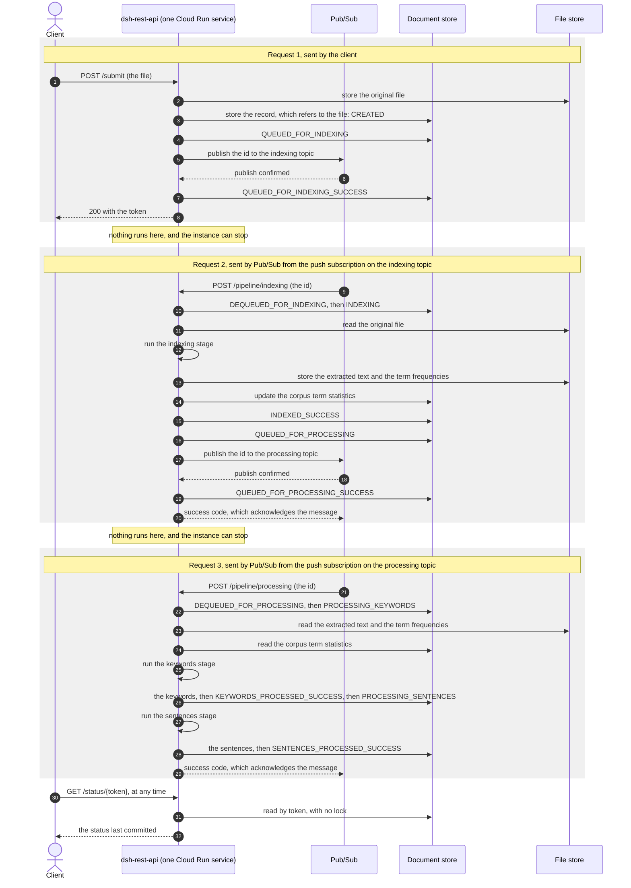

# Story 160 — ADR-003: decide the document pipeline, and revise ADR-001 to match

## 1. Story

**As a** developer about to build the document pipeline (Wave 2) and its GCP implementations
(Waves 5, 6 and 8)
**I want** one accepted record of how the pipeline is structured: its flow, its deployables, its
transports, how an implementation is selected, and where corpus statistics live
**So that** Wave 2's stories are written against decisions instead of each deciding them again, and
ADR-001 stops describing consumers that were never written

## 2. Context

- Wave: 1, task 2, the second half of step 2 of the order agreed on 2026-10-06
  (`specs/product/PRD.md` §4, Wave 1). DSH milestone `0.4.0-SNAPSHOT`. The first half, `#48`, is
  closed.
- Issue: [#160](https://github.com/MRISS-Projects/dsh/issues/160). **The issue is the source of
  truth for the acceptance criteria.** §6 maps each one to this spec.
- Parent branch: `DEVELOP`, at `043adc533` when this spec was written. The task branch is
  `issue-160-adr-003-document-pipeline`.
- **This story changes no production code, no test, no POM and no workflow.** Its output is one new
  document, `specs/architecture/ADR-003-document-pipeline.md`, a revision of
  `specs/architecture/ADR-001-GCP-based-components.md`, and small corrections to `CLAUDE.md` and to
  the build skill (§4).
- "The findings" means `specs/architecture/profiles-and-configuration.md`, the output of `#48`.
  Its probe ids (P0 to P31), finding ids (S1 to S8, M1 to M4), rule ids (R1 to R12) and GCP fact
  ids (G1 to G8) are used here as they are there.

### 2.1 What was established while writing this spec

All on `DEVELOP` at `043adc533`, on 2026-10-12.

| Fact | Evidence |
|---|---|
| Nothing consumes the queue. `dsh-rest-api` stores a document and sends its id to RabbitMQ, and no module reads it | `DocumentSubmissionServiceImpl`, `DocumentQueueServiceImpl`; no `inbound` adapter in any module |
| The four worker modules each hold one `Application` class and nothing else | `git ls-files '*/src/main/java/*.java'`: `DshDocIndexerApplication`, `DshDocProcessorWorkerApplication`, `DshKeywordExtractorApplication`, `DshTopSentencesExtractorApplication` |
| `dsh-doc-processor-worker` depends on the two extractor modules. Its only purpose was to run one after the other | `dsh-doc-analyser/dsh-doc-processor-worker/pom.xml` |
| `/submit` returns the token first. The document is stored and enqueued afterwards, on an `@Async` thread | `DocumentSubmissionServiceImpl.storeDocumentAndQueueForProcessing` |
| A document is never stored as `CREATED`. The first store happens after one `NEUTRAL` transition, so the first stored status is `QUEUED_FOR_INDEXING` | the same method |
| Status is written by saving the whole `Document`. There is no update of the status alone, and no conditional update | `DocumentDao` has `storeDocument`, three finders and `clearDocuments` |
| `DocumentStatus` has 18 states and models two queues: one before indexing and one before processing. Keywords and sentences run back to back with no queue between them | `DocumentStatus`; `specs/architecture/document-status-workflow.md` |
| `DocumentDao` names no technology. Only `DocumentRepository`, below it, extends `MongoRepository` | `dsh-data/…/document/dao/DocumentDao.java`, `…/mongo/DocumentRepository.java` |
| Solr is not used by any code. `IndexedDocumentDao` and `SOLRIndexedDocument` are empty, and the two plugins in `dsh-solr` are called by nothing | the two files; a grep for `solr` over every `*.java` outside `dsh-solr` |
| The API has `/submit` and `/status/{token}`. It has no search endpoint and no `order` parameter, although ADR-001 task 4.4 says one is "preserved" | `DocumentResource` |
| ADR-001's Context table says the workers "dequeue and process". Its refactoring table and its task 1.3 treat `dequeue-docId-context.xml` as production configuration to convert | `ADR-001-GCP-based-components.md:18`, `:59`, `:103` |
| `dequeue-docId-context.xml` exists only as a test resource of `dsh-rest-api`. Nothing references it, and it does nothing but log what it receives. **The PRD (§4, line 668) says it does not exist. That is wrong**, and §3.9 lists the correction. The body of `#160` said the same until 2026-10-13, when it was corrected with the owner's approval | `dsh-rest-api/src/test/resources/dequeue-docId-context.xml`; a grep for its name over every `*.java`, `*.xml`, `*.properties` and `*.yml` finds no reference |
| The original file is held inside the record today, as `byte[] originalFileContents`. Moving it to a file store is already planned and is not a decision of this story | `Document.java`; ADR-001 §3.1; PRD Wave 1 task 10 |
| `AdvancedNumberFilter` imports Lucene's analysis classes and nothing of Solr. The vector-order plugin imports Solr | the imports of the classes under `dsh-solr/*/src/main/java` |
| `NOT_INDEXED_ERROR` carries the description and message of `DEQUEUED_FOR_INDEXING` | `DocumentStatus.java`, the constant's constructor arguments. A follow-up candidate (§3.9), not part of this story |
| The findings cite one fact about Pub/Sub push: it posts each message to the service's URL, and a success code acknowledges it | G8. Every other fact about push in this spec is still to be cited (§3.10) |

### 2.2 Decisions agreed with the owner on 2026-10-12

These are the ADR's decisions. Step 4 writes them up; it does not reopen them. Each names the
alternatives that were put to the owner and rejected, because the ADR has to record them (AC002).

1. **Two asynchronous hops, as `DocumentStatus` already models.** Submit, hop 1, indexing, hop 2,
   then keywords and sentences together. `DocumentStatus` keeps its 18 states. With Solr gone,
   "indexing" means text extraction and the update of the corpus term statistics.
   *Rejected:* one hop, which removes three statuses from the status API and makes one request
   carry the whole document; and a hop per stage, which adds statuses and a topic for a split
   nobody has asked for.
2. **One deployable, `dsh-rest-api`, and the flow lives in it.** Everything else is a library that
   holds stage code and has no `Application` class. `dsh-keyword-extractor` and
   `dsh-top-sentences-extractor` are kept. `dsh-doc-indexer-worker` is kept and renamed
   `dsh-doc-indexer`. `dsh-doc-processor-worker` is removed. A later split into services is the
   same image deployed a second time, with the push subscriptions pointed at it.
   *Rejected:* the flow in a library module of its own, which adds a module boundary for a split
   that needs none; and keeping four empty applications.
3. **Under `gcp` each hop is a Pub/Sub topic with a push subscription to the same service.** The
   service publishes the document's id, and Pub/Sub calls the service back over HTTP. `/submit`
   stores and publishes before it answers. The PRD and the findings (§8.4) proposed push; the owner
   accepted it after seeing the request sequence of §3.3.
   *Rejected:* a subscriber that pulls, which needs an instance alive to poll and so breaks the
   cost rule (findings §8.4, G8).
4. **Corpus term statistics live in the document store, behind their own interface in
   `dsh-data`.** An implementation must bound the writes per document.
   *Rejected:* one statistics object in the file store, where concurrent documents contend for one
   object; and a fixed reference table shipped with the application.
5. **Vertex AI Search has no role in any planned wave.** A search across documents is recorded as
   a possible later feature. It is the one thing that would bring a search engine back, and it has
   two preconditions: an owner for each document, and a check of its cost against the cost rule.
   *Rejected:* keeping it, which builds a feature no requirement asks for.
6. **A run with no profile keeps documents and term statistics in memory.** Nothing else has to be
   installed to try DSH out.
   *Rejected:* the Firestore emulator as the only local store; and a store in local files.
7. **In memory arrives early and replaces MongoDB.** The in-memory document store is built in
   Wave 1 and the MongoDB code is deleted, not deprecated. No DSH installation holds MongoDB data
   to keep. No `DocumentPersistenceRepository` layer is added: `DocumentDao` is already neutral
   once MongoDB is gone.
   *Rejected:* MongoDB selectable beside it until Wave 9; and in memory arriving only in Wave 9.
   Both would have Wave 3 write a MongoDB implementation of the term statistics that Wave 9
   deletes.
8. **Uploads go to disk with no profile.** `dsh.file-store` is `local` with no profile and `gcs`
   under `gcp`. Wave 1 task 10 keeps its `LocalFileStorageService`. A file can outlive its record
   after a restart, and the ADR says so.
9. **Status is recorded by one component and advances by compare-and-set** (§3.2). No stage writes
   a status.
10. **Selection is a property per service, with `gcp` as the profile that sets them together.**
    The findings' placeholder names are made final (§3.4).
    *Rejected:* `@Profile` on each implementation, which chooses all the services at once and
    cannot put one of them on an emulator while another is on GCP (S4, P7).
11. **The request sequence under `gcp` is drawn in the ADR**, as a Mermaid diagram beside the
    transport decision. No planned diagram shows it: Wave 1 task 6 draws channels and stages,
    `#44` an overview, and Wave 2 task 1 the generated flow graph.
12. **The ADR states the three ways to run DSH, and a constraint on the image.** No profile; `gcp`
    in any GCP project, the owner's or an end user's; and local mode, which is `gcp` pointed at
    emulators. Nothing in the image names the owner's project. The mechanics of an end user's
    deployment stay with ADR-004 and Wave 10.
13. **`dsh-solr` is removed in Wave 2**, with the worker modules, not in Wave 9.
14. **ADR-001 is revised in place and stays `Proposed`**, with a revision note at its top that
    points to ADR-003. ADR-003's status is `Accepted`, and the owner's merge of the pull request
    is the acceptance.
15. **Every write of a status is atomic, and every read returns a committed state** (§3.2).
    `/status/{token}` can be asked at the moment a status changes. It answers with the status
    before the change or the status after it, and never waits for a writer. Atomicity is part of
    the store's contract, so each implementation owes it, in memory as much as on Firestore.
    *Rejected:* leaving it to each implementation, which is how a default store that never fails
    hides a defect that appears only on GCP.
16. **Every service outside the JVM is reached through an interface that names no technology**
    (§3.4). A consumer names the interface and never an implementation. Replacing a tool is one
    new implementation and one changed default, and no consumer changes. The build checks it:
    the GCP implementations live in a module of their own, `dsh-gcp`, which no other module can
    compile against (§3.6).
    *Rejected:* relying on Spring's habit of injecting by interface, which nothing enforces; an
    architecture test, which checks at test time, needs a new test dependency, and leaves the GCP
    libraries on the compile classpath of every stage library; and the GCP implementations inside
    `dsh-data`, as this spec first had it.
17. **Terms are extracted inside the JVM, by a library, in the indexing stage.** Solr was to do
    this, and no service replaces it. Which library is Wave 3 task 1's choice, as the PRD already
    says. A service for it would be a fifth interface under decision 16 and would need its own
    check against the cost rule.
    *Rejected:* choosing the library here, which is a decision about an algorithm's input and
    belongs with the story that has the fixtures to judge it.
18. **The indexing stage's output goes to the file store, and the record stays bounded** (§3.2).
    The extracted text and the document's own term frequencies are stored beside the original
    file. The record in the document store holds only what does not grow with the document: its
    status, its metadata, its references to the file store, and its results. Keywords and
    sentences run in a later request, possibly on another instance, so the output has to be
    stored, and Firestore limits the size of one document (F7).
    *Rejected:* the output in the record, which a long document pushes past that limit; and
    carrying it in the message, which is the document's id and nothing else (§3.2).

Decisions 15 to 18 come from the owner's review of this spec on 2026-10-13. The others are of
2026-10-12. In the same review the owner confirmed two points of decision 16: the `dsh-gcp` module
as the check, in place of the GCP implementations in `dsh-data`; and Spring Integration's
`MessageChannel` as the transport's interface, with no DSH interface in front of it (§3.4).

### 2.3 Inputs that this story does not reopen

- The owner's decisions of 2026-09-28 (PRD §4): the pipeline is built on the new interfaces and
  nothing new is built on RabbitMQ or Solr; the flow is Spring Integration's Java DSL, with stages
  as plain Java classes; Maven Central is ruled out; algorithms come before GCP.
- The owner's decisions of 2026-10-10 (PRD §4): the operated tiers and the `0.6.0` milestone.
- The cost rule in `CLAUDE.md`: Cloud Run's minimum instances is 0, always.

## 3. Design

### 3.1 The deliverable

`specs/architecture/ADR-003-document-pipeline.md`, in this order:

1. **Header.** The table ADR-001 uses: date, status `Accepted`, authors.
2. **Context.** What exists and what does not, from §2.1, and the inputs of §2.3.
3. **Decision.** One numbered section per question of AC003 to AC011, in that order. Each has the
   decision, its reason, and the alternatives rejected. Atomicity (decision 15) is part of the
   section on the flow, under its own heading. The interface rules (decision 16) are part of the
   section on selecting an implementation, under their own heading.
4. **The request sequence under `gcp`.** The diagram of §3.3, inside the section on the `gcp`
   transport.
5. **Ways to run DSH.** Decision 12.
6. **Evidence.** One table: each statement that rests on a fact, with the finding or probe it
   cites, or the documentation it cites and the label "Not verified by a run" (§3.10).
7. **Assumptions.** What only running code can show, each with the wave and task that proves it
   (§3.10).
8. **Consequences.** Positive and negative, as ADR-001 has them.
9. **Consequences for the waves.** The table of §3.9, its "After the merge" paragraph, and the
   follow-up candidates.
10. **Alternatives considered.** The rejected options of §2.2, in one table.
11. **References.**

The ADR uses product names (Firestore, Pub/Sub, Cloud Run), as the PRD's Wave 1 task 5 requires of
ADRs and developer pages.

### 3.2 The pipeline at run time

**The flow.** One `IntegrationFlow`, defined with the Java DSL in `dsh-rest-api`: a gateway, hop 1,
the indexing stage, hop 2, the keywords stage, the sentences stage. The message carries the
document's id and nothing else. A stage reads what it needs from the stores.

**A stage.** A plain Java class in its library module. It imports nothing from Spring Integration
and never writes a status. It reports failure by throwing.

**Stages are idempotent.** Running a stage twice for one document leaves the same result. Pub/Sub
delivers at least once, so a stage can be asked to run again. This is a requirement on Wave 3's
stages, and above all on the term statistics update, which must count a document once (§3.5).

**What each step reads and writes.** A message carries only an id, and two steps can run on two
instances, so everything a later step needs is in a store.

| Step | Reads | Writes |
|---|---|---|
| `/submit` | nothing | the original file, to the file store; then the record, which refers to it |
| Indexing | the original file | its output, to the file store: the extracted text and the document's own term frequencies. Then the corpus term statistics (§3.5) |
| Keywords | the indexing stage's output, and the corpus term statistics | the keywords, to the record |
| Sentences | the indexing stage's output, and the corpus term statistics | the top sentences, to the record |

- **The record is bounded.** It holds the status, the metadata, the references to the file store,
  and the results. Whatever grows with the document is in the file store. Firestore limits the
  size of one document (F7). The results stay bounded only if the number of keywords and of
  sentences returned has a limit, which Wave 3 tasks 4 and 6 set.
- **An object is stored before the record refers to it**, and a result before its success status
  (§3.2, atomicity). A failure between the two leaves an object that nothing refers to, never a
  reference to nothing.
- **A repeat replaces, and does not add.** The indexing stage run twice for one document leaves
  one output in the file store. `FileStorageService` has to allow that, which the signature the
  PRD sketches for Wave 1 task 10, `store(byte[]) → URI`, does not (§3.9).
- **Terms are extracted by a library inside the JVM** (decision 17). The indexing stage calls it.
  The form of the output, and the library, are Wave 3 task 1's to choose.

**The status recorder.** One component in `dsh-rest-api` records every transition. It is attached
at two kinds of point: around every stage, and on each hop. It never names a status. It applies a
`TransitionType`, and `DocumentStatus.transition` picks the next state, so the generated diagram
stays the only definition of the state machine.

The twelve points, checked against all 18 states:

| # | Point | Applies | From | To |
|---|---|---|---|---|
| 1 | hop 1, id sent | `NEUTRAL` | `CREATED` | `QUEUED_FOR_INDEXING` |
| 2 | hop 1, outcome of the send | `SUCCESS` or `ERROR` | `QUEUED_FOR_INDEXING` | `QUEUED_FOR_INDEXING_SUCCESS` or `QUEUED_FOR_INDEXING_ERROR` |
| 3 | hop 1, id received | `NEUTRAL` | `QUEUED_FOR_INDEXING_SUCCESS` | `DEQUEUED_FOR_INDEXING` |
| 4 | indexing starts | `NEUTRAL` | `DEQUEUED_FOR_INDEXING` | `INDEXING` |
| 5 | indexing ends | `SUCCESS` or `ERROR` | `INDEXING` | `INDEXED_SUCCESS` or `NOT_INDEXED_ERROR` |
| 6 | hop 2, id sent | `NEUTRAL` | `INDEXED_SUCCESS` | `QUEUED_FOR_PROCESSING` |
| 7 | hop 2, outcome of the send | `SUCCESS` or `ERROR` | `QUEUED_FOR_PROCESSING` | `QUEUED_FOR_PROCESSING_SUCCESS` or `QUEUED_FOR_PROCESSING_ERROR` |
| 8 | hop 2, id received | `NEUTRAL` | `QUEUED_FOR_PROCESSING_SUCCESS` | `DEQUEUED_FOR_PROCESSING` |
| 9 | keywords start | `NEUTRAL` | `DEQUEUED_FOR_PROCESSING` | `PROCESSING_KEYWORDS` |
| 10 | keywords end | `SUCCESS` or `ERROR` | `PROCESSING_KEYWORDS` | `KEYWORDS_PROCESSED_SUCCESS` or `KEYWORDS_NOT_PROCESSED_ERROR` |
| 11 | sentences start | `NEUTRAL` | `KEYWORDS_PROCESSED_SUCCESS` | `PROCESSING_SENTENCES` |
| 12 | sentences end | `SUCCESS` or `ERROR` | `PROCESSING_SENTENCES` | `SENTENCES_PROCESSED_SUCCESS` or `SENTENCES_NOT_PROCESSED_ERROR` |

The document is stored as `CREATED` before point 1. Today it is not (§2.1).

**Compare-and-set.** An advance names the status it expects to find, and applies only if the stored
status is still that one. A plain save of the whole document is not enough: under `gcp`, Pub/Sub
can deliver to a second instance before the first has recorded point 2, and the first instance's
late save would then overwrite newer state. That is the class of defect `#142` describes. Three
rules follow:

- **Receiving an id proves the send succeeded.** At points 3 and 8, if the sender has not yet
  recorded the outcome, the receiver advances through it. The sender's late write then finds the
  status changed, and is dropped.
- **An advance that finds the document already at its target changes nothing.** The stage still
  runs, because stages are idempotent.
- **A stage is skipped when the document is already past it**, or is in a status it never leaves.
  The message is acknowledged.

The conditional update is a requirement on `DocumentDao`, which Wave 1's reshaped tasks 8 and 9
add (§3.9).

**Atomicity.** Compare-and-set is only correct if the comparison and the write are one operation.
Five requirements follow. Each is part of the contract of `DocumentDao`, not a property of one
implementation, so a store added later owes them too (§3.4).

1. **An advance is atomic.** No other write to the same document can come between the comparison
   and the write. Two callers that attempt the same advance at once get one success and one "found
   it changed".
2. **A read returns a committed state.** A reader sees the document as it was before a write or as
   it is after, and never part of a write. A reader takes no lock and does not wait for a writer.
   `/status/{token}` is such a read. Asked while a status is changing, it answers with the old
   status or the new one, and both are true answers to "the status recorded so far".
3. **A status that reports success is written after the result it reports is stored.** A reader can
   find a result whose status still says the stage is running. A reader never finds a status that
   claims a result which is not there.
4. **After the first store, no write replaces the whole document.** Each write changes the fields
   it names: the status, or one stage's result. Saving a whole `Document` that was read earlier is
   the write that loses an update, and it is what the code does today (§2.1).
5. **A caller holds a copy, never the stored object.** The in-memory store keeps its own copy and
   returns copies. Without that, a caller that changes a `Document` changes the store without a
   write, and a test passes in memory for behaviour Firestore does not have.

How each implementation meets them:

| | `dsh.persistence=memory` | `dsh.persistence=firestore` |
|---|---|---|
| The advance | one atomic operation on the map's entry | a transaction that reads the document and writes the status only if it matches (F7) |
| A read | a copy of the entry | a read outside any transaction, which returns the latest committed version and takes no lock (F9) |
| Two advances collide | the second finds the status changed | Firestore makes the second wait or run again, and after a finite number of attempts fails it (F10). That failure is "a store cannot be reached" in the table below |

The design does not depend on how Firestore resolves a collision. Its Standard edition locks the
documents a transaction reads, and its Enterprise edition detects the conflict at commit (F10). A
read followed by a conditional write inside one transaction is correct under both. Which edition
DSH uses is ADR-004's and Wave 5's to choose.

The Firestore emulator "does not currently implement all transaction behavior seen in production"
(F11). So the emulator proves the advance for one caller, and only Firestore itself proves it for
two (assumption A3).

**Failures.**

| What fails | Status recorded | Message |
|---|---|---|
| A stage throws | its `…_ERROR` status | consumed; under `gcp` the request answers with a success code |
| The send on a hop fails | the hop's `…_ERROR` status | none was sent |
| A store cannot be reached, or gives up on a write after contention | none | not consumed; under `gcp` the request answers with a failure, and Pub/Sub delivers again |
| A repeat arrives for a document past the stage | none | consumed |

How many times Pub/Sub delivers again, and what happens to a message that keeps failing, is a
setting of the subscription. It is left to Wave 6's story, with the facts of §3.10 to start from.

**`/submit` behaves the same in both modes.** It stores the document, sends the id on hop 1, and
returns the token after point 2 is recorded. The `@Async` call after the response is removed. With
zero minimum instances, work after a response gets no CPU (G8, findings §8.4).

**The hops, by transport.**

| | `dsh.transport=memory` | `dsh.transport=pubsub` |
|---|---|---|
| Send | a channel backed by an executor in the JVM | a publish to the hop's topic, whose outcome is awaited |
| Receive | the executor's thread | a push subscription posts to an endpoint of the service, which hands the id to the flow |
| Endpoints used | none | one per hop |

The paths of the two endpoints and the names of the two topics are Wave 6's to fix. The topics take
the prefix the findings propose (§6.3), which ADR-004 decides. The endpoints must accept requests
from Pub/Sub only. How depends on whether the service is public, which is ADR-004's subject, so
ADR-003 states the requirement and leaves the mechanism there.

### 3.3 The request sequence under `gcp`

This diagram goes into the ADR as it is, in the section on the `gcp` transport. The endpoint paths
and topic names in it are placeholders, and the ADR says so.



With no profile the statuses and their order are the same. Requests 2 and 3 do not exist: each hop
is a channel in the JVM. The ADR says this in one sentence under the diagram and draws no second
diagram.

### 3.4 Selection and configuration

**The keys.** These are the findings' placeholders (§6.3), made final, with the defaults changed by
decisions 6 to 8.

| Key | With no profile | Under `gcp` | Selects |
|---|---|---|---|
| `dsh.persistence` | `memory` | `firestore` | the `DocumentDao` implementation, and the term statistics implementation with it |
| `dsh.transport` | `memory` | `pubsub` | what a hop is |
| `dsh.file-store` | `local` | `gcs` | the `FileStorageService` implementation |

- The profile is named `gcp`. Its file, `application-gcp.properties` in `dsh-rest-api`, sets the
  right-hand column. Each key can still be set alone, which is what lets a local run put one
  service on an emulator and another on GCP (P7).
- Term statistics have no key of their own. They are stored where the documents are.
- The `local` file store writes under a directory given by one more key, whose name the ADR fixes
  and whose default Wave 1 task 10 chooses.
- **No `rabbitmq`, `mongodb` or `legacy` profile ever exists.** `dshApplicationContext.xml` and
  `enqueue-docId-context.xml` are deleted with the code they wire (§3.9). Neither goes under a
  profile, and neither is rewritten in Java. That answers AC009: S5 shows the profile route is
  possible, and it is not needed. All new wiring is Java configuration.

**The interfaces.** Each key selects the implementation of one interface. These are the only
places where DSH meets a service outside the JVM.

| Service | Interface | With no profile | Under `gcp` |
|---|---|---|---|
| Document store | `DocumentDao`, in `dsh-data` | in memory, in `dsh-data` | Firestore, in `dsh-gcp` |
| Term statistics | named by Wave 3 task 2, in `dsh-data` | in memory, in `dsh-data` | Firestore, in `dsh-gcp` |
| File store | `FileStorageService`, in `dsh-data` (Wave 1 task 10) | `LocalFileStorageService`, in `dsh-data` | Cloud Storage, in `dsh-gcp` |
| Transport | a hop's two message channels, which the flow names in `dsh-rest-api` | an executor joins them | a publish and a push endpoint join them, in `dsh-gcp` |

The transport's interface is Spring Integration's `MessageChannel`, not one DSH defines. The flow
is its only consumer, and the owner's decision of 2026-09-28 already builds the flow on Spring
Integration. A DSH interface in front of the channel would add a layer that the channel already
is.

Five rules, which the ADR states as rules:

1. **An interface names no technology**: not in its name, its method signatures, its types or its
   exceptions. An implementation turns its provider's failures into the exception the interface
   declares. The status recorder depends on that, because it has to tell "the store cannot be
   reached" from "the stage failed" (§3.2, failures).
2. **A consumer names the interface, never an implementation.** That covers the flow, the status
   recorder, the stages, the API's resources and services, and one implementation's use of
   another.
3. **One implementation of each interface is in the context**, chosen by the key. A value that
   matches none stops the startup (R11, P8).
4. **Replacing a tool is three changes**: a new implementation, a new value for the key, and that
   value as the default where the old one was set. No consumer changes, and no interface changes.
   A replacement that needs a change to an interface shows that the interface named the old tool,
   and the ADR treats that as a defect in the interface.
5. **The behaviour is in the contract, and the contract is tested once.** What an implementation
   owes beyond its signatures is written on the interface: the atomic advance (§3.2), the
   document counted once (§3.5). Each interface has one contract test, and every implementation
   passes the same one. The in-memory implementation runs it as a unit test, and the Firestore
   one against the emulator. Where the test class lives, so that two modules can run it, is
   Wave 1 task 8's to choose.

**How the build checks rules 1 and 2.** Every class that imports a provider's type lives in
`dsh-gcp` (§3.6). `dsh-rest-api` depends on that module at `runtime` scope, and no other module
depends on it. A class anywhere else that names a Firestore, Pub/Sub or Cloud Storage type does
not compile. Spring's injection by interface is a habit; the module boundary is the check. That
the context finds the implementations in a module the application cannot compile against is
assumption A5.

**Rules of the findings (§6.1) that the ADR puts in force.**

| Rule | In force by ADR-003 | Note |
|---|---|---|
| R1, a profile names a capability, never a tier | yes | |
| R2, with no profile nothing on GCP is reached | yes | its defaults are the table above, not MongoDB |
| R3, a profile's file sets defaults, and a property selects each implementation | yes | |
| R4, an emulator is `gcp` with its endpoints redirected | yes | Cloud Storage has no official emulator (G6) |
| R7, only the deployable has `application*.properties` | yes | the deployable is `dsh-rest-api` (decision 2) |
| R11, each profile has a context test, and each selectable interface has a consumer that is always present | yes | the flow consumes all three, so a mistyped value stops the startup (P8) |
| R12, profile files do not set the same key | yes | |
| R5, the tier is one value, the base name | left to ADR-004 | |
| R6, a required value is bound through a validated class | left to ADR-004 | |
| R8, the build stamps the version and the commit, and nothing else | left to ADR-004 | |
| R10, every context test names its profile | left to ADR-004 | it lands in `testing-patterns.md` with layer 5 |
| R9, Spring configuration is filtered with `@…@` only | neither | already `#158` |

**Ways to run DSH.**

| Way | Set by | Reaches |
|---|---|---|
| No profile | nothing | nothing outside the JVM, except a local directory for uploads and for the indexing stage's output |
| `gcp` | the deployment, in any GCP project | Firestore, Pub/Sub and Cloud Storage in that project |
| Local mode | `gcp`, with endpoint values pointed at emulators | each service on an emulator or on GCP, one by one |

**The constraint on the image.** Nothing in the jar or the image names the owner's GCP project.
Every GCP resource name comes from values set where the application is deployed (R5, P10), so the
image the owner runs is the image an end user runs.

### 3.5 Corpus term statistics

- **Where.** In the document store, behind an interface of their own in `dsh-data`. In memory with
  no profile; in Firestore under `gcp`.
- **What the interface must offer.** Record the distinct terms of one document, counting that
  document once however often it is called. Read the number of documents that contain each of a
  set of terms. Read the number of documents in the corpus. The names and signatures are Wave 3
  task 2's to choose.
- **The constraint on an implementation.** The writes per document are bounded by a number that
  does not grow with the document's vocabulary. Firestore bills by the write, and a document can
  hold thousands of distinct terms (§3.10). Grouping terms into a fixed number of records is one
  way to meet it. The ADR states the constraint, not the layout.
- **Atomicity.** The update for one document is all or nothing, and the record that the document
  was counted is part of the same atomic write. A failure half way leaves no partial count, and a
  repeat finds the record and changes nothing. Two documents that raise the same term's count at
  once both take effect. On Firestore a transaction gives both (F12), and the bound on writes is
  also what keeps the update inside one transaction. Contention between documents that update the
  same records is the cost, and it ends as it does for a status: the write fails after a finite
  number of attempts, and Pub/Sub delivers again (§3.2).
- **What a reader sees.** The keywords stage reads the counts committed when it reads. Its own
  document is already counted, because indexing comes first. Documents still in the pipeline may or
  may not be. So the keywords of a document depend on the corpus at the time it was processed, and
  the ADR says so.
- **When.** The interface and the in-memory implementation are Wave 3 task 2. The Firestore
  implementation is needed in Wave 5, inside `0.6.0`, or the pipeline cannot finish on the first
  GCP release.

### 3.6 Modules

Once Wave 2 is done:

| Module | Role |
|---|---|
| `dsh-rest-api` | The deployable: the API, the flow, the status recorder. It depends on `dsh-gcp` at `runtime` scope |
| `dsh-data` | Models, the store interfaces, and the in-memory and local implementations. It depends on no provider's library |
| `dsh-gcp` | New in Wave 5. A library: every class that names a GCP type. The Firestore and Cloud Storage implementations in Wave 5; the Pub/Sub side of the two hops, with their push endpoints, in Wave 6 |
| `dsh-doc-indexer` | A library: the indexing stage. Renamed from `dsh-doc-indexer-worker` |
| `dsh-keyword-extractor` | A library: the keywords stage |
| `dsh-top-sentences-extractor` | A library: the sentences stage |
| `dsh-doc-analyser` | The parent of the two extractor modules, as today |
| `dsh-doc-processor-worker` | Removed |
| `dsh-solr`, with its two plugins | Removed. The number filter is a Lucene filter with no Solr import (§2.1). If Wave 3 task 1 chooses Lucene's analysis library, the filter and its tests come back from git history nearly as they are |
| `dsh-test-dataset`, `dsh-coverage-report` | Unchanged |

**How a stage becomes a service later.** Under `gcp` a stage is started by an HTTP request, so
whatever runs one is a web application. A split is the same image deployed as a second Cloud Run
service, with a hop's push subscription pointed at it. It needs no second deployable in the build
and no code change.

**A second provider later** is a module beside `dsh-gcp`, with its own implementations of the same
interfaces and its own values for the three keys (§3.4, rule 4).

### 3.7 The ADR-001 revision

ADR-001 stays the record of why DSH moves to GCP and onto which services. It is edited in place,
which its `Proposed` status allows, and it keeps that status.

| Part of ADR-001 | Change |
|---|---|
| Header | A revision note is added below it: the date, that ADR-003 revised it, and a list of what changed |
| Context table | Says what the code does today: `dsh-rest-api` enqueues and nothing dequeues; Solr is called by no code |
| Decision 1, "Deprecate Current Implementations — Do Not Remove" | Reversed. The legacy code is removed, because it has no consumers and no data (decisions 7 and 13) |
| Decision 2, interface first | Kept, and made a rule the build checks (decision 16). Selection is by property, as ADR-003 decides |
| Current interface inventory | `DocumentDao` stays. `DocumentQueueService` goes with the RabbitMQ path. The `DocumentRepository` row and the refactoring table below it are removed |
| §3.1, Firestore and Cloud Storage | Kept. The repository class named there is replaced by a `DocumentDao` implementation. Cloud Storage also holds the indexing stage's output (decision 18) |
| §3.2, Pub/Sub | Rewritten for push to the same service, two topics, and no worker |
| §3.3, Vertex AI Search | Removed |
| Phase 1 | Only the file storage task survives, without "deprecated". Tasks 1.3 to 1.6 are removed. Tasks 1.1 and 1.2 are replaced by the in-memory `DocumentDao` and the removal of MongoDB |
| Phase 2 | Task 2.5, the migration utility, is removed. `@Profile("gcp")` becomes selection by property. Term statistics on Firestore are added. The implementations go into the new `dsh-gcp` module |
| Phase 3 | Rewritten to match Wave 6 |
| Phase 4 | Removed |
| Phase 5 | Rewritten to match Wave 9: the parity comparison and the `legacy` profile are gone |
| Consequences, Alternatives | Brought in line: no dual implementations, no backward compatibility through deprecated code, no loss of term vectors to a search engine |
| References | Entries for Solr classes are removed. Entries for code that still exists stay |

Until `dsh-plan-wave` has applied §3.9, the PRD and ADR-003 differ in places: the PRD still gives
Wave 8 contents, for one. Where they differ, ADR-001 follows ADR-003, and the revision note says
that the PRD is being brought in line.

Each phase names the PRD wave that delivers it. The wave numbers are those of the re-plan of
2026-10-10, and the revision note says so, because a later re-plan will move them.

### 3.8 Evidence and wording

- A statement about Spring or Maven behaviour cites a finding or a probe id of the findings.
- A statement about GCP cites a fact id: G1 to G8 from the findings, or one of the new facts of
  §3.10. Each new fact carries its URL, the date it was read, the words quoted, and the label
  "Not verified by a run".
- A statement that neither can support is an assumption, and is listed as one.
- The findings' convention is "proposed, not in force". The ADR says which of its rules it puts in
  force (§3.4). It does not edit the findings, which are a dated record.

### 3.9 Consequences for the waves, and follow-up candidates

**This story does not edit the PRD.** The ADR lists the consequences, and the PRD changes go
through `dsh-plan-wave` afterwards. Wave numbers are those of 2026-10-10.

| Where | Consequence |
|---|---|
| Wave 1 task 3, ADR-004 | Search needs no real GCP project. Protecting the push endpoints is its decision. It inherits R5, R6, R8 and R10 |
| Wave 1 tasks 5 and 6, the wiki | Their diagrams draw from §3.2 and §3.3. Task 6's page can link to the ADR's sequence diagram |
| Wave 1 task 8 | Becomes: add the conditional status advance to `DocumentDao`, and an in-memory implementation that is the default. The contract of §3.2 is written on the interface: the atomic advance, writes by field, copies. The task also writes the contract test of §3.4, with a case of two callers attempting one advance at once |
| Wave 1 task 9 | Becomes: remove MongoDB. That is `MongoDocumentDao`, `DocumentRepository`, `dshApplicationContext.xml`, `mongo.properties`, the MongoDB dependencies, the MongoDB container that `-DintegrationTests` starts, and the `mongo.*` values in six workflows and in the `settings.xml` instructions |
| Wave 1 task 10 | Nothing is marked deprecated. The file store holds two kinds of object, the original file and the indexing stage's output. The interface lets a caller store an object so that a repeat replaces it, which `store(byte[]) → URI` alone does not |
| Wave 2 task 1 | `/submit` stores and sends before it answers. The status recorder and its twelve points. `#142`'s test proves assumption A1. Its list of what to delete gains the unused test resource `dequeue-docId-context.xml` |
| Wave 2 task 3 | The module table of §3.6, `dsh-solr` included |
| Wave 3 task 1 | Terms are extracted by a library inside the JVM, and the choice of library stays with this task. Its output goes to the file store, not into the record (decisions 17 and 18) |
| Wave 3 task 2 | The term statistics interface of §3.5, with an in-memory implementation and a contract test. The update is atomic |
| Wave 3, every stage | Idempotent (§3.2). It stores its result through the store's interface, in a write that names its fields, before the recorder writes the success status |
| Wave 5 | Creates the `dsh-gcp` module. Gains term statistics on Firestore, with bounded writes. Its implementations pass the contract tests of Waves 1 and 3 against the emulator, and the case of two callers against Firestore itself (A3) |
| Wave 6 | Two topics and two push subscriptions per tier, an outbound publish whose outcome is awaited, two push endpoints, and the redelivery settings. The Pub/Sub classes go into `dsh-gcp` |
| Wave 8 | Empty |
| Wave 9 task 2 | Nothing left to remove |
| Wave 11 | A backlog line: search across documents, with its two preconditions (decision 5) |

**Follow-up candidates.** Each is a draft for the owner to accept, change or drop. None is acted
on by this story (AC014).

1. **`#157`, give `mongo.*` its values at run time.** It has no purpose once MongoDB is removed.
   It is next in the order of work, so it should not start.
2. **`#140`, remove the unused `spring.data.mongodb.*` settings.** No purpose, or reduced to the
   part the findings added: renaming the test properties file (§9.2, candidate 4).
3. **`#158`, `#137` and `#120`.** Still valid, each with less to cover: no `mongo.properties`, no
   MongoDB or RabbitMQ container, fewer dependencies.
4. **The PRD re-plan**, through `dsh-plan-wave`, from the table above.
5. **`NOT_INDEXED_ERROR`'s description and message are those of `DEQUEUED_FOR_INDEXING`**
   (§2.1). A small defect in `dsh-data`, visible through `/status/{token}`.
6. **The PRD says `dequeue-docId-context.xml` does not exist** (§2.1). It exists as an unused test
   resource. The PRD's sentence (§4, "The 2026-09-28 re-plan") is corrected in the re-plan of
   candidate 4. The same sentence in `#160`'s Context was corrected on 2026-10-13, with the
   owner's approval, to: "it treats `dequeue-docId-context.xml`, an unused test resource, as
   production configuration".
7. **`CLAUDE.md` and `specs/architecture/system-design.md` describe MongoDB, RabbitMQ and Solr as
   current.** They are right until the code is removed. The stories that remove it should correct
   them.

**After the merge.** The ADR records the consequences, and it changes no plan by itself. They
become work in this order, and the ADR carries this paragraph below its consequences table.

1. **The PRD is reconciled** (`dsh-reconcile-prd`), which marks `#160` closed and changes no plan.
2. **The waves are re-planned** (`dsh-plan-wave`), from the consequences table, **before any other
   story starts**. `#157` is next in Wave 1's order of work and has lost its purpose, and tasks 8
   to 10 still have their old shape in the PRD. A story started before the re-plan starts from a
   plan this ADR has overturned.
3. **The re-plan ends with a mapping**: one line for each row of the consequences table, naming
   the PRD task that now carries it, or saying that the row needs no task and why. The owner
   reads the mapping with the wave contents, before the PRD is written. A row with no line is a
   consequence that was dropped.
4. **Each reshaped task becomes a story when its turn comes** (`dsh-new-story`). The consequence is
   written there as acceptance criteria, which is what makes it binding on the build.
5. **The follow-up candidates are settled in the same session as the re-plan.** For an existing
   issue, a comment or an edit is drafted, and posted once the owner approves it. Closing an issue
   is the owner's. A new defect becomes an issue if the owner wants it tracked.

### 3.10 Facts to cite, and assumptions

**New facts.** Each is read from the provider's documentation during the build and recorded with
its URL, the date and the words quoted. A fact that cannot be found documented is dropped from the
ADR, or moved to the assumptions.

| Id | What it has to establish | Used by |
|---|---|---|
| F1 | The body of a push request: where the message's data and id are | §3.2, the endpoints |
| F2 | What answer acknowledges a push, what happens on any other answer, and how long a push request may take before Pub/Sub treats it as failed | §3.2, failures |
| F3 | Pub/Sub delivers at least once, so a message can arrive more than once | §3.2, idempotent stages |
| F4 | How a subscription limits redelivery: retry policy, dead-letter topic, message retention | §3.2, left to Wave 6 |
| F5 | How a push subscription can identify itself to the endpoint | §3.2, the requirement on the endpoints |
| F6 | Firestore bills by document write, read and delete | §3.5, the constraint |
| F7 | Firestore's limit on the size of a document, and that a transaction can read a document and write it conditionally | §3.2 compare-and-set, and the bounded record; §3.5 |
| F8 | Spring Cloud GCP's inbound channel adapter for Pub/Sub receives by pulling, and its outbound adapter can report the outcome of a publish | §3.2, the hops |
| F9 | A Firestore read outside a transaction returns the latest committed version and takes no lock, and a write to one document is atomic | §3.2, atomicity |
| F10 | How Firestore resolves two transactions on one document, in each edition, and how the loser ends | §3.2, atomicity |
| F11 | Where the Firestore emulator differs from Firestore on transactions | §3.2, atomicity; A3 |
| F12 | A Firestore transaction or batched write is atomic across documents, and its limits on writes and on size | §3.5, atomicity |

G8 of the findings already covers Cloud Run's CPU allocation and the push delivery itself.

F9 to F11 were read on 2026-10-13, to answer the owner's question in review. The build quotes them
again from the page, and does not copy them from here. "Not verified by a run" applies to each.

| Id | Read at | Words quoted |
|---|---|---|
| F9 | `docs.cloud.google.com/firestore/native/docs/understand-reads-writes-scale` | "a Firestore read returns the latest version of the data that reflects all writes that have been committed up until the start of the read"; of reads: "Since they do not acquire locks, they do not block concurrent read-write transactions"; "A write to a single document requires updating both the document and its associated index entries atomically in the storage layer" |
| F10 | `docs.cloud.google.com/firestore/native/docs/transaction-data-contention` | "Cloud Firestore guarantees serializable isolation of transactions"; "The default for Standard edition is `PESSIMISTIC`. The default for Enterprise edition is `OPTIMISTIC`"; "When a transaction locks a document, other write operations must wait for the transaction to release its lock"; "After a finite number of retries, the transaction operation fails and returns an error message: ABORTED: Too much contention on these documents. Please try again." |
| F11 | `firebase.google.com/docs/emulator-suite/connect_firestore` | "The emulator does not currently implement all transaction behavior seen in production. When you're testing features that involve multiple concurrent writes to one document, the emulator may be slow to complete write requests. In some cases, locks may take up to 30 seconds to be released." |

The page read for F12, `firebase.google.com/docs/firestore/manage-data/transactions`, says "either
all of the operations succeed, or none of them are applied". The limits were not found on it and
are still to be read.

**Assumptions.** Each is something only running code can show.

| Id | Assumption | Proved by |
|---|---|---|
| A1 | In the Java DSL, an advice around each stage and an interceptor on each hop's channel see all twelve points of §3.2 | Wave 2 task 1, with `#142`'s test of two overlapping submissions |
| A2 | Under `gcp`, the outcome of a publish is known inside the request that made it | Wave 6, at layer 5a against `dsh-dev` |
| A3 | Firestore applies the conditional status advance atomically: of two callers attempting one advance at once, one succeeds | Wave 5. One caller at layer 3 against the emulator; two callers at layer 5a against `dsh-dev`, because of F11 |
| A4 | A layout of the term statistics exists that bounds the writes per document, fits Firestore's limits, and lets one transaction cover the update | Wave 5 |
| A5 | The application's context finds the implementations in `dsh-gcp`, a module it depends on at `runtime` scope, and its own classes cannot compile against that module's types | Wave 5, by the context test of the `gcp` profile (R11) and by the build |

### 3.11 Out of scope

As the issue lists it:

- Any code. The flow is Wave 2 task 1, the worker modules are Wave 2 task 3, and the `dsh-data`
  interfaces are Wave 1 tasks 8 to 10.
- Distribution, which is ADR-004: the operated tiers, the GCP names, the deploy, the bucket, the
  cost rule service by service, layer 5 and the release gate.
- Editing `specs/product/PRD.md`.
- The wiki pages and their diagrams.
- The Spring Boot line (`#120`).
- `specs/architecture/system-design.md`, the findings and the story specs.

And from this spec:

- Changing or closing any issue (§3.9's candidates).
- `DocumentStatus` and `specs/architecture/document-status-workflow.md`. The design changes no
  status (decision 1), so AC011's list is empty and the ADR says so.
- The paths, topic names and redelivery settings of Wave 6.
- The library that extracts text and terms, and the form of the indexing stage's output. Both are
  Wave 3 task 1's.

## 4. Files to change

| File | Change |
|---|---|
| `specs/architecture/ADR-003-document-pipeline.md` | New. §3.1 |
| `specs/architecture/ADR-001-GCP-based-components.md` | Revised in place. §3.7 |
| `CLAUDE.md` | One row in the router table: "The document pipeline: flow, modules, transports and selection" leading to ADR-003. Two statements that would contradict the revised ADR-001 are corrected: the opening paragraph's list of GCP services, and the `dsh-solr` row's pointer (T5) |
| `.claude/skills/dsh-build-story/SKILL.md` | Its two bullets on ADR-001 tell every build to select by a `gcp` or `legacy` profile and to "deprecate, do not delete". Decisions 7 and 10 overturn both, and the next code story would be built under them. They are replaced by ADR-003's rule (T5) |
| `specs/stories/160-adr-003-document-pipeline.md` | This spec |

Nothing else. No POM, workflow, properties file, XML context, Java class or test appears in the
diff.

The issue says the story changes `specs/architecture/` and `CLAUDE.md` only. The skill file is
outside that sentence and inside AC016, which allows documentation. It was added when the plan was
written, on 2026-10-13, and the owner approves it with the plan.

## 5. Verification

### 5.1 Every decision is closed

- Each of AC003 to AC011 has a numbered section in the ADR's Decision part, with a decision, a
  reason and at least one rejected alternative. AC009 and AC011 are closed by saying why nothing is
  needed.
- `grep -n -i "to be decided\|TBD\|open question" specs/architecture/ADR-003-document-pipeline.md`
  prints nothing.
- What the ADR leaves to another story is named with that story: the endpoint protection (ADR-004),
  and the paths, topics and redelivery settings (Wave 6).

### 5.2 Nothing unverified reads as verified

- Each of F1 to F12 that the ADR keeps has a URL, an access date, quoted words and the label
  "Not verified by a run".
- No sentence in the ADR states GCP behaviour without a G or F id beside it.
- Each of A1 to A5 names the wave and task that proves it.
- The word "atomic" appears in the ADR's sections on the flow and on term statistics, each time
  with what is atomic and which fact or assumption supports it.
- Every probe, finding and rule id the ADR cites exists in the findings:
  `grep -o "\b[PSMRG][0-9]\+\b" specs/architecture/ADR-003-document-pipeline.md | sort -u`, each
  checked against `specs/architecture/profiles-and-configuration.md`.

### 5.3 ADR-001 does not contradict ADR-003

In `specs/architecture/ADR-001-GCP-based-components.md`, each of these appears only inside the
revision note, or not at all: `dequeue-docId-context.xml`, `@Profile("rabbitmq")`,
`@Profile("legacy")`, `@Deprecated`, `Vertex`, `discoveryengine`, `TermVectorOrderingService`,
`DocumentPersistenceRepository`, `migration utility`, `dequeue and process`.

### 5.4 The documents are well formed

- The markdown lint command in `CLAUDE.md` reports nothing.
- The Mermaid block is rendered by GitHub on the task branch's view of the file. It is looked at
  there once, because no local renderer is installed (§7.2, C7).
- The router row's link resolves: the file it names exists.

### 5.5 Nothing else changed

`git diff --stat DEVELOP...HEAD` lists the five files of §4 and no other.

### 5.6 The gates

`mvn -B clean install`, logged to `.logs/mvn-clean-install.log` as `CLAUDE.md` requires. Expected:
exit 0. Gate 3 does not apply: no code changed.

## 6. Acceptance criteria

The criteria are the issue's. The column says where this spec covers each.

| AC | Covered by |
|---|---|
| AC001: the ADR exists, with ADR-001's parts, status `Accepted`, lint clean | §3.1, decision 14, §5.4, T3, C1, C4 |
| AC002: every decision closed, with reason and rejected alternatives | §2.2, §3.1, §5.1, T3, C1 |
| AC003: the flow, a stage, the one place status is recorded | §3.2, with decision 15 on atomicity; T3, section 1 |
| AC004: the deployables, a later split, each worker module's fate | decision 2, §3.6; T3, section 2 |
| AC005: selection, final key and profile names, the no-profile defaults, the rules put in force | §3.4, with decision 16 on interfaces; T3, section 3 |
| AC006: how a stage starts on Cloud Run with zero instances, within the cost rule | decision 3, §3.2, §3.3; T3, section 4; C7 |
| AC007: where document frequency is stored and updated, in both modes | decision 4, §3.5; T3, section 5 |
| AC008: Vertex AI Search's role, `dsh-solr`, local runs | decisions 5 and 13, §3.6, §3.9; T3, section 6 |
| AC009: the XML contexts | §3.4; T3, section 7 |
| AC010: no profile after the legacy code is gone | decisions 6 to 8, §3.4; T3, section 8 |
| AC011: the statuses | decision 1, §3.2, §3.11; T3, section 9 |
| AC012: evidence, labels and assumptions | §3.8, §3.10, §5.2, T2, T3, C2 |
| AC013: ADR-001 revised in place, with no contradiction left | decision 14, §3.7, §5.3, T4, C3 |
| AC014: consequences for the waves; PRD untouched; no issue changed before approval | §3.9, §5.5, T3, T7, C6 |
| AC015: `CLAUDE.md`'s router leads to ADR-003 | §4, §5.4, T5, C5 |
| AC016: documentation only | §4, §5.5, T6, C6 |

## 7. Tasks

Written on 2026-10-13, after the owner approved §1 to §6. `dsh-build-story` (step 4) runs the tasks
in order. Each task is one commit.

**Goal.** ADR-003 exists with every decision closed, and ADR-001, `CLAUDE.md` and the build skill
no longer say anything that contradicts it.

**How the work is tested.** There is no Java under test. The checks of §5 are the tests, and §7.2
writes them as commands. T1 runs them before anything is written and records that they fail. Each
later task ends with the checks it has to turn green.

### 7.1 Constraints on every task

- **The diff holds the five files of §4 and no other.** No POM, workflow, properties file, XML
  context, Java class or test.
- **Not touched:** `specs/product/PRD.md`, `specs/architecture/profiles-and-configuration.md`,
  `specs/architecture/system-design.md`, `specs/architecture/document-status-workflow.md`,
  `DocumentStatus`, and every GitHub issue.
- **Evidence.** A sentence about Spring or Maven behaviour carries a probe, finding or rule id of
  the findings. A sentence about GCP carries a G id or an F id. Whatever neither supports is an
  assumption, A1 to A5, with the wave and task that proves it.
- **Wording.** Product names: Firestore, Pub/Sub, Cloud Run, Cloud Storage. Wave numbers are those
  of the re-plan of 2026-10-10, and each document says so once. The endpoint paths and topic names
  are placeholders, and the ADR says so where they appear.
- **Nothing is copied from memory.** A quotation is copied from the page it cites, on the day it is
  read.
- **Lint before every commit**, with check C4. A commit message is the one the task gives, and it
  ends with the attribution trailers in force for the session.
- **The shell keeps no state between commands.** Every command block below starts with the prelude
  of §7.2, from the repository root.

### 7.2 The checks

The prelude:

```bash
export PATH="$HOME/apps/node-v24.21.0-win-x64:$PATH"
SPEC=specs/stories/160-adr-003-document-pipeline.md
ADR3=specs/architecture/ADR-003-document-pipeline.md
ADR1=specs/architecture/ADR-001-GCP-based-components.md
FIND=specs/architecture/profiles-and-configuration.md
```

**C1, every decision is closed (§5.1).** Each of the nine numbered sections of the ADR's Decision
part holds one paragraph that starts `**Decision.**`, one that starts `**Reason.**` and one that
starts `**Rejected.**`.

```bash
test -f "$ADR3" && echo "the ADR exists"
grep -n '^| \*\*Status\*\* *| Accepted' "$ADR3"
grep -c '^### [1-9]\. ' "$ADR3"
grep -c '^\*\*Decision\.\*\*' "$ADR3"
grep -c '^\*\*Reason\.\*\*' "$ADR3"
grep -c '^\*\*Rejected\.\*\*' "$ADR3"
grep -n -i 'to be decided\|TBD\|open question' "$ADR3"
awk '/^## Alternatives considered/{f=1;next} /^## /{f=0} f && /^\| /' "$ADR3" | wc -l
```

Expected: `the ADR exists`; one status line; `9` four times; nothing from the fifth `grep`; `24`,
which is a header, a separator and 22 alternatives.

**C2, nothing unverified reads as verified (§5.2).**

```bash
for id in $(grep -o '\b[PSMRG][0-9]\+[ab]\?\b' "$ADR3" | sort -u); do
  grep -q "\b$id\b" "$FIND" || echo "$id is not in the findings"
done
for n in $(seq 1 12); do
  grep -q "^| F$n |.*https://.*Not verified by a run" "$ADR3" || echo "F$n has no complete row"
done
for n in 1 2 3 4 5; do
  grep -q "^| A$n |.*Wave [0-9]" "$ADR3" || echo "A$n names no wave"
done
grep -n -i 'atomic' "$ADR3"
```

Expected: nothing from the first loop. From the second, only the facts T2 dropped, each of which
§8 names. Nothing from the third. From the last `grep`, lines inside section 1 and section 5 of
the Decision part, each read once against §5.2's last bullet.

One part of §5.2 has no command: that no sentence states GCP behaviour without a G or F id beside
it. T3 does it by reading the ADR once from top to bottom for that alone.

**C3, ADR-001 does not contradict ADR-003 (§5.3).** The revision note is the section headed
`## Revision note`. The command drops it and searches the rest.

```bash
awk '/^## Revision note/{s=1;next} /^## /{s=0} !s' "$ADR1" | grep -n -F \
  -e 'dequeue-docId-context.xml' -e '@Profile("rabbitmq")' -e '@Profile("legacy")' \
  -e '@Deprecated' -e 'Vertex' -e 'discoveryengine' -e 'TermVectorOrderingService' \
  -e 'DocumentPersistenceRepository' -e 'migration utility' -e 'dequeue and process'
```

Expected: nothing. On `DEVELOP` at `043adc533` it prints 34 lines.

**C4, the lint.**

```bash
markdownlint 'specs/**/*.md' '.github/**/*.md' 'docs/**/*.md' 'CLAUDE.md' '.claude/**/*.md' \
  --ignore 'docs/wiki/**' --config .markdownlint.json; echo "lint exit=$?"
```

Expected: `lint exit=0` and no finding.

**C5, the ADR can be found (§5.4).**

```bash
grep -n 'ADR-003-document-pipeline.md' CLAUDE.md .claude/skills/dsh-build-story/SKILL.md
grep -n 'Vertex\|legacy\|do not delete' CLAUDE.md .claude/skills/dsh-build-story/SKILL.md
```

Expected: three lines from the first `grep`, two in `CLAUDE.md` and one in the skill. Nothing from
the second.

**C6, nothing else changed (§5.5).**

```bash
git diff --stat DEVELOP...HEAD
```

Expected: the five files of §4 and no other.

**C7, the diagram (§5.4).** The Mermaid block is checked on GitHub, which is the only renderer at
hand. The spec is pushed before the build starts, so its own copy can be looked at first:
`https://github.com/MRISS-Projects/dsh/blob/issue-160-adr-003-document-pipeline/specs/stories/160-adr-003-document-pipeline.md`,
at §3.3. The ADR's copy is then shown to be the same text:

```bash
diff <(awk '/^```mermaid/{f=1;next} /^```/{f=0} f' "$SPEC") \
     <(awk '/^```mermaid/{f=1;next} /^```/{f=0} f' "$ADR3") && echo "the diagrams are the same"
```

Expected: a drawn sequence diagram with five participants and three shaded bands on GitHub, and
`the diagrams are the same`.

### 7.3 The tasks

- [x] **T1 — record the red state.** Before any file of §4 is changed.

  1. Run C1, C3 and C5. Expected: C1 prints nothing for `test -f` and an error for each `grep`,
     because the ADR does not exist. C3 prints 34 lines. C5's first `grep` prints nothing, and its
     second prints the three lines that T5 removes. Keep the outputs for §8.
  2. Look at the spec's diagram on GitHub, as C7 describes. If it is drawn, go on. If GitHub shows
     the source or an error, correct the block in §3.3 until it is drawn, lint, and commit:
     `docs(#160): correct the sequence diagram's syntax`. The ADR copies the block, so it is
     corrected here first.
  3. Nothing else is committed by this task.

- [x] **T2 — establish F1 to F12.** Read each page, and note the URL, the date and the words that
  state the fact. The notes stay in the session's scratchpad until T3 writes them into the ADR.
  The starting pages for F1 to F8 and F12 are from memory and may have moved. F9 to F11 were read
  on 2026-10-13 (§3.10).

  | Id | Start from |
  |---|---|
  | F1, F2 | `https://docs.cloud.google.com/pubsub/docs/push` |
  | F3 | `https://docs.cloud.google.com/pubsub/docs/subscription-overview` |
  | F4 | `https://docs.cloud.google.com/pubsub/docs/handling-failures` and `https://docs.cloud.google.com/pubsub/docs/subscription-properties` |
  | F5 | `https://docs.cloud.google.com/pubsub/docs/authenticate-push-subscriptions` |
  | F6 | `https://docs.cloud.google.com/firestore/pricing` |
  | F7, F12 | `https://docs.cloud.google.com/firestore/quotas` and `https://firebase.google.com/docs/firestore/manage-data/transactions` |
  | F8 | Spring Cloud GCP's reference documentation, the line that supports Spring Boot 2.7, its section on the channel adapters for Pub/Sub. Note the version read |
  | F9 to F11 | the three pages of §3.10, read again |

  1. For each fact, decide: kept, with its quotation; or not found. A fact that is not found is
     dropped, or becomes an assumption with the wave that proves it (§3.10). Every sentence of §3
     that rested on it is then worded as an assumption in the ADR.
  2. If a page contradicts a decision of §2.2, stop. Tell the owner what the page says, and do
     not write the ADR around it.
  3. Nothing is committed by this task.

- [x] **T3 — write `specs/architecture/ADR-003-document-pipeline.md`.**

  1. Create the file with these headings, in this order, and the header table ADR-001 uses: date,
     status `Accepted`, authors `Backend Development Team`.

     ```text
     # ADR-003: The Document Pipeline
     ## Context
     ### What exists today
     ### Inputs
     ## Decision
     ### 1. The flow
     ### 2. The deployables
     ### 3. Selecting an implementation
     ### 4. The `gcp` transport
     ### 5. Corpus term statistics
     ### 6. Vertex AI Search
     ### 7. The XML contexts
     ### 8. A run with no profile
     ### 9. The statuses
     ## Ways to run DSH
     ## Evidence
     ## Assumptions
     ## Consequences
     ### Positive
     ### Negative
     ## Consequences for the waves
     ### After the merge
     ### Follow-up candidates
     ## Alternatives considered
     ## References
     ```

  2. Write Context from §2.1 and §2.3. Leave out what §2.1 says about the PRD's and the issue's
     wording.
  3. Write the nine decision sections. Each starts with three paragraphs, `**Decision.**`,
     `**Reason.**` and `**Rejected.**`, and then holds the detail under `####` headings.

     | Section | Answers | Written from | Rejected alternatives it records |
     |---|---|---|---|
     | 1. The flow | AC003 | §3.2 entire: the flow, a stage, idempotent stages, what each step reads and writes, the status recorder and its twelve points, compare-and-set, atomicity, failures, `/submit`. Decisions 1, 9, 15, 17, 18 | decision 1's two, 15's one, 17's one, 18's two |
     | 2. The deployables | AC004 | decisions 2 and 13; §3.6, with both "later" paragraphs | decision 2's two |
     | 3. Selecting an implementation | AC005 | §3.4: the keys, the interfaces, the five rules, how the build checks them, the rules of the findings put in force | decision 10's one, 16's three |
     | 4. The `gcp` transport | AC006 | decision 3; §3.2, the hops by transport; §3.3, the diagram and the sentence about a run with no profile | decision 3's one |
     | 5. Corpus term statistics | AC007 | decision 4; §3.5 | decision 4's two |
     | 6. Vertex AI Search | AC008 | decisions 5 and 13. A local run needs no real GCP project because of search | decision 5's one |
     | 7. The XML contexts | AC009 | §3.4, the bullet on the two XML contexts | under a profile as they stand (S5); rewritten in Java first |
     | 8. A run with no profile | AC010 | decisions 6, 7 and 8 | decision 6's two, 7's two |
     | 9. The statuses | AC011 | decision 1; §3.11. No status is added, removed or renamed, and the section says so in those words | the two of section 1 again, because each would change the statuses |

  4. Copy §3.3's Mermaid block into section 4 unchanged.
  5. Write "Ways to run DSH" from §3.4: the table and the constraint on the image.
  6. Write Evidence as two tables. The first lists each statement that rests on the findings, with
     its id. The second has one row for each G or F fact used, and one id to a row: the id, what
     it establishes, the words quoted, the source as a full `https://` URL, the date read, and
     `Not verified by a run`.
  7. Write Assumptions as §3.10's table, A1 to A5, plus any fact T2 moved there.
  8. Write Consequences.

     - Positive: one deployable, and a run with no profile needs nothing installed. No instance
       waits on a queue, so nothing costs while idle. Status has one writer and one definition,
       the generated diagram. Replacing a tool is an implementation and a default. No dual
       implementations, no migration and no deprecated code to carry. Four empty applications and
       the Solr module go.
     - Negative: `/submit` answers later, because it stores and publishes first. One document
       takes three requests, each of which can meet a cold start. Delivery is at least once, so
       every stage must be idempotent. Documents that update the same term records contend, and a
       write that gives up is delivered again. With no profile everything is lost at a restart,
       and a file can outlive its record. Search across documents does not exist and needs a new
       decision. A document's keywords depend on the corpus at the time it was processed. The
       atomic advance can be proved for two callers only on Firestore itself, in Wave 5.

  9. Write "Consequences for the waves" from §3.9: the table, then "After the merge", then the
     follow-up candidates. Candidate 6 says what was corrected in `#160`, as §3.9 does.
  10. Write "Alternatives considered" as one table of 22 rows: the alternative, the decision it
      lost to, and the reason. One row for each alternative in step 3's last column, counting
      section 9's repeats once.
  11. Write References: the findings, ADR-001, the PRD, `document-status-workflow.md`, this spec,
      `#48`, `#142` and `#160`, and the paths of `DocumentDao`, `DocumentStatus`,
      `DocumentResource` and `DocumentSubmissionServiceImpl`.
  12. Read the ADR once from top to bottom for one thing: a sentence about GCP with no G or F id
      beside it. Give it one, or word it as an assumption.
  13. Run C1, C2, C4 and C7's `diff`. Expected: as §7.2 states.
  14. Commit: `docs(#160): ADR-003, the document pipeline`.

- [x] **T4 — revise `specs/architecture/ADR-001-GCP-based-components.md`.**

  1. Add this section between the header table's rule and `## Context`, with the date of the day,
     and one bullet for each row of §3.7 that changes something, in the table's order:

     ```markdown
     ## Revision note

     Revised on YYYY-MM-DD under `#160`, by [ADR-003](./ADR-003-document-pipeline.md), which
     decides the document pipeline. This ADR keeps its status, `Proposed`. It stays the record of
     why DSH moves to GCP and onto which services. What changed:

     - (one bullet for each changed row of the spec's §3.7)

     Each phase now names the PRD wave that delivers it. The wave numbers are those of the
     re-plan of 2026-10-10, and a later re-plan will move them. Until the PRD has been re-planned
     from ADR-003's consequences, it differs from this ADR in places. Where they differ, this ADR
     follows ADR-003.
     ```

  2. Apply §3.7 row by row, top to bottom. The phases map to waves like this: Phase 1 to Wave 1
     tasks 8 to 10, Phase 2 to Wave 5, Phase 3 to Wave 6, Phase 5 to Wave 9. Phase 4 is removed,
     and Phase 5 keeps its number, so that an older document that cites "Phase 5" still points at
     the right one.
  3. Read the revised ADR-001 against the eighteen decisions of §2.2, one decision at a time. A
     sentence that contradicts one is corrected or removed.
  4. Run C3 and C4. Expected: C3 prints nothing, and `lint exit=0`.
  5. Commit: `docs(#160): revise ADR-001 to match ADR-003`.

- [x] **T5 — `CLAUDE.md` and the build skill.**

  1. In `CLAUDE.md`'s opening paragraph, replace `(Firestore, Pub/Sub, Vertex AI Search)`, which
     wraps over two lines, with `(Firestore, Pub/Sub, Cloud Storage)`. After the paragraph's last
     sentence add: "How the
     document pipeline is built, with and without GCP, is decided in
     `specs/architecture/ADR-003-document-pipeline.md`."
  2. In the router table, add below the row for ADR-001:
     ``| The document pipeline: flow, modules, transports and selection | `specs/architecture/ADR-003-document-pipeline.md` |``
  3. In the Modules table, change the `dsh-solr` row's parenthesis from "proposed for replacement
     — see ADR-001" to "to be removed — see ADR-003". Nothing else in `CLAUDE.md` changes:
     MongoDB, RabbitMQ and Solr are still in the code (§3.9, candidate 7).
  4. In `.claude/skills/dsh-build-story/SKILL.md`, replace the two bullets that start "ADR-001
     requires **interface-first** work" and "Deprecate, do not delete" with:

     ```markdown
     - ADR-003 requires **interface-first** work: a service outside the JVM is reached through an
       interface that names no technology, and its implementation is selected by a property
       (`dsh.persistence`, `dsh.transport`, `dsh.file-store`) that the `gcp` profile sets. See
       `specs/architecture/ADR-003-document-pipeline.md`.
     - Code that ADR-003 replaces is deleted, not deprecated.
     ```

  5. Run C5 and C4. Expected: as §7.2 states.
  6. Commit: `docs(#160): point CLAUDE.md and the build skill at ADR-003`.

- [x] **T6 — gates and record.**

  1. `mvn -B clean install`, logged to `.logs/mvn-clean-install.log` as `CLAUDE.md` requires, with
     the exit code reported. Expected: exit 0. Gate 3 does not apply: no code changed.
  2. Run C1 to C6 once more, all of them. Expected: as §7.2 states.
  3. Add §8, "Verification results", to this spec: the commit the build started from, T1's red
     outputs, each fact of T2 as kept, dropped or moved, the output of every check, and the gate's
     exit code. Tick the tasks done. Lint. Commit: `docs(#160): record the verification`.

- [ ] **T7 — hand over.** Show the owner three things, and post or change nothing without
  approval: the follow-up candidates of §3.9; the "After the merge" order, with the re-plan first;
  and the issue's sentence that names only `specs/architecture/` and `CLAUDE.md`, which §4 now
  exceeds by one file. The pull request is opened in step 6, by `dsh-ship-story`, and the owner's
  merge of it is ADR-003's acceptance.

## 8. Verification results

Built on 2026-10-13, from `ca2e20c6a` on `issue-160-adr-003-document-pipeline`, with `DEVELOP` at
`043adc533`. T1 to T6 are ticked above. T7 is the message that ends the build session, so it is
not ticked by this commit.

### 8.1 The red state (T1)

Run before any file of §4 was changed.

| Check | Output |
|---|---|
| C1 | `test -f` printed nothing. Each `grep` and the `awk` answered `No such file or directory` |
| C3 | 34 lines |
| C5, first `grep` | nothing |
| C5, second `grep` | three lines: `CLAUDE.md:5` (`Vertex AI`), and `SKILL.md:19` and `:21` (`legacy`, `Deprecate, do not delete`) |

### 8.2 The facts (T2)

All twelve were found and kept. None was dropped or moved to the assumptions, and no page
contradicted a decision of §2.2. Each page was downloaded on 2026-10-13, and every quotation in
the ADR's F rows was then searched for in the downloaded text by a script: 40 quotations, all
found on the page their row names, except the compatibility values of F8, which are on the same
reference's index page, as that row says.

| Id | Result | Note |
|---|---|---|
| F1 | kept | |
| F2 | kept, two rows | The second row is the acknowledgment deadline: 10 seconds by default, 600 at most, and not extendable for a pushed message. The ADR states it in section 1, under "Failures", and hands the setting to Wave 6 |
| F3 | kept | |
| F4 | kept, two rows | `handling-failures` redirects to `dead-letter-topics`. A dead-letter topic's maximum number of delivery attempts is 5 at the least |
| F5 | kept | |
| F6 | kept | `docs.cloud.google.com/firestore/pricing` redirects to `cloud.google.com/firestore/pricing`, which is the URL cited |
| F7 | kept, two rows | The size limit from the quotas page, the conditional write from the transactions page |
| F8 | kept, two rows | Version read: 3.9.0, whose compatibility table pairs the 3.x line with Spring Boot 2.6.x and 2.7.x |
| F9 | kept | The three quotations of §3.10 are on the page word for word |
| F10 | kept | One quotation of §3.10 differs from the page, which now says "Firestore guarantees serializable isolation of transactions", without "Cloud". The ADR quotes the page |
| F11 | kept | Word for word |
| F12 | kept, two rows | The limits read are on size, 10 MiB, and on time, 270 seconds. No limit on the number of writes in one transaction was found on either page, and the ADR says so |

### 8.3 The checks, after T5

| Check | Output | As expected |
|---|---|---|
| C1 | `the ADR exists`; `6:\| **Status**  \| Accepted`; `9`, `9`, `9`, `9`; nothing from the fifth `grep`; `24` | yes |
| C2, the ids | nothing. The ids cited are G1, G2, G6, G8, M1, M4, P0, P7, P8, P10, P17, P31, R1 to R12, S1, S2, S4 to S8 | yes |
| C2, the F rows | nothing: every one of F1 to F12 has a complete row | yes |
| C2, the A rows | nothing | yes |
| C2, `atomic` | 17 lines. See below | in part |
| C3 | nothing | yes |
| C4 | `lint exit=0`, no finding | yes |
| C5 | three lines, `CLAUDE.md:8`, `CLAUDE.md:24` and `SKILL.md:21`; nothing from the second `grep` | yes |
| C6 | the five files of §4 and no other | yes |
| C7, the `diff` | `the diagrams are the same` | yes |
| C7, the look on GitHub | a drawn sequence diagram with five participants and three shaded bands, looked at after the build. See §8.4 | yes, late |

**C2's last `grep`.** §7.2 expects lines inside sections 1 and 5 of the Decision part only. Nine
of the 17 are there, at lines 83 to 228 and 545 to 569, and each was read against §5.2's last
bullet: each says what is atomic and names the fact or the assumption beside it, or is a heading
or the name of a rejected alternative. The eight others are outside those sections, and each
repeats text this spec prescribes: rule 5 of §3.4 (line 392), the quotations of F9 and F12 (737,
740), assumption A3 (753), the last negative consequence of T3 step 8 (782), two rows of §3.9's
table (796, 802), and the alternatives table's row for decision 15 (861). §7.2's expectation was
narrower than the content the same spec asks for.

**The reading for GCP sentences (T3 step 12).** Done once, top to bottom. Four sentences were
changed by it: the one on a push reaching a second instance, which now cites G8 for the push and
states the ordering as the design's own reasoning; two that said nothing costs while idle, which
now say only that no instance is kept alive (G8), because the findings leave the idle cost of
Firestore and Pub/Sub unestablished (§8.3 there); and the F12 row, which gained the quotation for
a transaction that runs again.

### 8.4 Departures from this spec

1. **The diagram was looked at on GitHub after the build, not before it** (T1 step 2, C7). The
   Chrome extension was not connected during the build. In its place the block of §3.3 was
   parsed with Mermaid 12.2.0, which accepted it as a sequence diagram, and rejected a
   deliberately broken copy. The look was done once Chrome was connected, on 2026-10-13, at this
   spec's §3.3 on the task branch, as pushed at `ca2e20c6a`. GitHub drew the diagram: the five
   participants, the three shaded bands headed "Request 1", "Request 2" and "Request 3", the two
   notes between them, and the numbered arrows as far as number 25. The last arrows, below the
   keywords stage, were scrolled past and not seen. The ADR's copy was not looked at, because
   the ADR is not pushed yet; C7's `diff` shows it is the same text.
2. **A key was named.** §3.4 leaves the name of the `local` file store's directory key to the
   ADR. It is `dsh.storage.local-directory`, beside the findings' `dsh.storage.bucket` and
   `dsh.storage.prefix`.
3. **Three reasons were worded during the build.** §2.2 records these alternatives as rejected
   without a reason of their own, and AC002 asks for one: keeping four empty applications, a
   fixed reference table for the term statistics, and a store in local files. The owner should
   read the three rows in the ADR's alternatives table.
4. **ADR-001, two sentences beyond §3.7's table**, both found by T4 step 3. Its §3.1 said the
   `Document` model would carry a Firestore annotation, which decision 16 rules out; the mapping
   is now in `dsh-gcp`. Its §3.2 said dead-letter topics handle FR001's "retry up to 3 times"
   natively, which F4 contradicts; it now says the mapping does not settle that requirement.

### 8.5 One observation for the owner

`specs/features/indexing-workflow.md`, FR001, says "Failed tasks must be retried up to 3 times
before marking as failed". The design of §3.2 records a stage's `…_ERROR` status on its first
failure and consumes the message. The two differ. Neither file was changed, because §3.2 is a
decision this story does not reopen and the feature specs are outside §4. It is raised in T7.

### 8.6 The gates

`mvn -B clean install`, logged to `.logs/mvn-clean-install.log`, run after T5's commit
(`1b093d6d5`): `maven exit=0`, `BUILD SUCCESS` for all 13 modules of the reactor in 01:22 min,
finished at 16:10 on 2026-10-13. `All coverage checks have been met` was printed eight times,
once for each module with production sources. That is gates 1 and 2. Gate 3 does not apply: no
code changed.
