# Story 192 — Wiki page on Spring Integration: how the pipeline's flow is built, with a diagram

## 1. Story

**As a** developer about to build the pipeline's flow in Wave 2 (task 1, the walking skeleton, and
task 4, repeats and failures)
**I want** a wiki page that explains how DSH uses Spring Integration: the one flow, its gateway and
two hops, where the stages and the status recorder attach, and what joins a hop's channels under
each transport, with a diagram of the flow
**So that** I start from a short map of ADR-003 sections 1 and 4 in Spring Integration's own terms,
instead of rebuilding that picture from a thousand-line ADR

## 2. Context

- Wave: 1, task 6 (`specs/product/PRD.md` §4, Wave 1). DSH milestone `0.4.0-SNAPSHOT`.
- Issue: [#192](https://github.com/MRISS-Projects/dsh/issues/192). Its inputs are closed: task 2,
  `#160` (ADR-003), and task 5, `#44`, which moved the wiki's source into `docs/wiki/` and
  publishes it on every push to `DEVELOP` that changes it.
- Parent branch: `DEVELOP`, at `82c8d184b` when this spec was written. The task branch is
  `issue-192-wiki-spring-integration`.
- Sources: `specs/architecture/ADR-003-document-pipeline.md` sections 1, 2, 3, 4 and 7, and its
  assumptions A1 and A2; the rules for a page in `docs/wiki/README.md`.

### 2.1 What exists today

On `DEVELOP` at `82c8d184b`:

- **Spring Integration is in `dsh-rest-api` only, wired in XML.** Its POM declares
  `spring-boot-starter-integration`, `spring-integration-stream` and `spring-integration-amqp`.
  `DshRestApplication` imports `enqueue-docId-context.xml` with `@ImportResource`.
- **That context sends a document's id to RabbitMQ.** It declares the channel `toRabbit`, with a
  wire-tap to a logging adapter, and an AMQP outbound channel adapter on it that publishes to
  `si.test.exchange` with correlated publisher confirms. Confirms, nacks and returns are turned
  into text and published on `toRabbitResponse`.
- **`DocumentQueueServiceImpl` sends the id on `toRabbit`.** `DocumentSubmissionServiceImpl`
  calls it after `/submit` has answered, on an `@Async` thread (ADR-003, "What exists today").
  `DocumentEnqueueResponseMessageHandler` handles the confirm.
- **Nothing receives the id.** `dequeue-docId-context.xml` is a test resource of `dsh-rest-api`
  that only logs what it receives, and nothing references it.
- **None of the decided flow is built.** No `IntegrationFlow` exists, the three stage modules hold
  no code, and `dsh-gcp` does not exist.
- **Wave 2 task 1 deletes the enqueue path.** Its PRD entry lists `enqueue-docId-context.xml`,
  `DocumentQueueServiceImpl`, its handlers, the AMQP dependencies, the RabbitMQ container of
  `-DintegrationTests` and `dequeue-docId-context.xml`. It says the story corrects `CLAUDE.md` and
  `specs/architecture/system-design.md` where they describe RabbitMQ as current. It names no wiki
  page, although Home and Architecture already describe the enqueue path as current ("Only the
  first step exists today", "today `dsh-rest-api` sends it on hop 1").
- **The wiki's "Names" rule** lists generic terms for Home and Architecture: queue, NoSQL store,
  file store. Home and Architecture also use "document store", for the role that DSH fills in
  memory by default, and the rule does not say so.

## 3. Design

### 3.1 Decisions

- **D1. One new page, `docs/wiki/Spring-Integration.md`,** published as "Spring Integration", and
  linked from Developers under "Other pages for developers".
- **D2. The page decides nothing.** Each section links to the part of ADR-003 that makes its
  decisions, and the page says that the ADR wins where the two differ. Where the ADR leaves a
  point open, the page is silent on it too. Two such points shaped the text: which of a hop's two
  channels carries each of the recorder's hop points, and how the flow tells a store's failure
  from a stage's own (Wave 2 task 1's to build).
- **D3. "Today" is dated.** The section names the commit and the date it describes, so it stays
  true after Wave 2 task 1 deletes the enqueue path. The owner chose this on 2026-11-17, with D4,
  over an undated section and over a dated one with no follow-up.
- **D4. The PRD's Wave 2 task 1 gains the wiki.** Its sentence on what the story corrects adds the
  wiki pages Home, Architecture and Spring Integration. One clause, outside `docs/wiki/`, beyond
  the issue's "Affected modules: none"; the owner approved it with D3.
- **D5. The gateway is where `/submit` hands the id to the flow.** ADR-003 lists "a gateway" first
  in the flow, and says `/submit` stores, sends on hop 1, and answers after point 2. The PRD's Wave
  2 task 1 says "a gateway receives a submitted document id". The page states both and links them.
- **D6. Neither table nor sequence is copied.** The twelve points and the request sequence under
  `gcp` are linked, not reproduced (AC003, AC004). The page names the points only by their numbers
  in the diagram, with a link to the table.
- **D7. The diagram is a Mermaid `flowchart LR`.** The main line runs `POST /submit`, gateway,
  hop 1, indexing stage, hop 2, keywords stage, sentences stage. Each hop is a subgraph holding its
  send channel, what joins the two channels, and its receive channel. The status recorder is one
  node, with an edge to each stage, labelled "advice" and its points, and an edge to each hop's
  subgraph, labelled "interceptor" and its points. The edge goes to the subgraph, not to one
  channel, because of D2's first open point.
- **D8. Only `POST /submit` is drawn as built.** Every other node, subgraph and edge is planned and
  follows the wiki's rule: "(planned)" in its label, a dashed outline, dashed edges into it.
- **D9. `dsh-gcp` is described as ADR-003 section 2 has it:** new in Wave 5, with the Pub/Sub side
  of the hops and their push endpoints in Wave 6.
- **D10. The "Names" sentence** goes into the rule before its last sentence, worded as the issue's
  AC008 has it.

### 3.2 The page

`docs/wiki/Spring-Integration.md`, verbatim except for the two values in Task 2, Step 3.

````markdown
# Spring Integration

DSH's document pipeline is built on Spring Integration. This page is a map of how: the one flow,
its gateway and its two hops, where the stages and the status recorder attach, and what joins a
hop's two channels under each transport. It decides nothing. Every decision on it is
[ADR-003](https://github.com/MRISS-Projects/dsh/blob/DEVELOP/specs/architecture/ADR-003-document-pipeline.md)'s,
and each section links to the part of the ADR that makes it. Where this page and the ADR differ,
the ADR is right.

## Today

On `DEVELOP` at `SHA`, on DATE, none of the flow below is built. Spring Integration is in
`dsh-rest-api`, wired in XML, and does one thing: it sends a document's id to RabbitMQ.

- `dsh-rest-api`'s POM declares `spring-boot-starter-integration`, `spring-integration-amqp` and
  `spring-integration-stream`.
- `DshRestApplication` imports `enqueue-docId-context.xml` with `@ImportResource`. The context
  declares a channel, `toRabbit`, and an AMQP outbound channel adapter on it, which publishes to
  RabbitMQ with publisher confirms. The confirms come back on a second channel,
  `toRabbitResponse`.
- `DocumentQueueServiceImpl` sends the id on `toRabbit`. It is called after `/submit` has
  answered, on an `@Async` thread.
- Nothing receives the id. `dequeue-docId-context.xml`, a test resource that only logs what it
  receives, is referenced by nothing.

Wave 2 task 1 deletes the enqueue path: the context, `DocumentQueueServiceImpl` and its handlers,
the AMQP dependencies, and the unused `dequeue-docId-context.xml`
([ADR-003, section 7](https://github.com/MRISS-Projects/dsh/blob/DEVELOP/specs/architecture/ADR-003-document-pipeline.md#7-the-xml-contexts);
[the PRD's Wave 2](https://github.com/MRISS-Projects/dsh/blob/DEVELOP/specs/product/PRD.md#wave-2--pipeline-walking-skeleton)).
It builds the flow below in their place. All new wiring is Java configuration.

## The flow

The pipeline is one `IntegrationFlow`, written with the Java DSL, in `dsh-rest-api`
([ADR-003, section 1](https://github.com/MRISS-Projects/dsh/blob/DEVELOP/specs/architecture/ADR-003-document-pipeline.md#1-the-flow)).
In order:

1. **A gateway.** `/submit` stores the document as `CREATED` and hands its id to the flow here.
   It answers with the token once point 2, the outcome of hop 1's send, is recorded
   ([`/submit`](https://github.com/MRISS-Projects/dsh/blob/DEVELOP/specs/architecture/ADR-003-document-pipeline.md#submit)).
2. **Hop 1**, asynchronous.
3. **The indexing stage.**
4. **Hop 2**, asynchronous.
5. **The keywords stage.**
6. **The sentences stage**, straight after the keywords stage, with no hop between them.

A message carries the document's id and nothing else. A stage reads what it needs from the
document store and the file store, and its result is written back to them
([what each step reads and writes](https://github.com/MRISS-Projects/dsh/blob/DEVELOP/specs/architecture/ADR-003-document-pipeline.md#what-each-step-reads-and-writes)).

A stage is a plain Java class in a library module: the indexing stage in `dsh-doc-indexer`, the
keywords stage in `dsh-keyword-extractor`, the sentences stage in `dsh-top-sentences-extractor`
([a stage](https://github.com/MRISS-Projects/dsh/blob/DEVELOP/specs/architecture/ADR-003-document-pipeline.md#a-stage);
[the modules](https://github.com/MRISS-Projects/dsh/blob/DEVELOP/specs/architecture/ADR-003-document-pipeline.md#the-modules)).
It imports nothing from Spring Integration, never writes a status, and reports a failure by
throwing. The flow calls it. A stage knows nothing of channels, hops or transports.

## The status recorder

One component in `dsh-rest-api` records every change of status
([the status recorder](https://github.com/MRISS-Projects/dsh/blob/DEVELOP/specs/architecture/ADR-003-document-pipeline.md#the-status-recorder)).
It attaches at two kinds of point:

- **Around every stage**, as an advice: where the stage starts, and where it ends in success or
  in error.
- **On each hop's channel**, as an interceptor: where the id is sent, where the outcome of the
  send is known, and where the id is received.

That these two kinds of attachment see all twelve points is assumption A1, which Wave 2 task 1
proves
([assumptions](https://github.com/MRISS-Projects/dsh/blob/DEVELOP/specs/architecture/ADR-003-document-pipeline.md#assumptions)).

The recorder never names the status a document moves to. It applies a `TransitionType`,
`NEUTRAL`, `SUCCESS` or `ERROR`, and `DocumentStatus.transition` picks the next status. What the
recorder does know is the status each point expects to find, because it advances by
compare-and-set: an advance applies only if the stored status is still the expected one
([compare-and-set](https://github.com/MRISS-Projects/dsh/blob/DEVELOP/specs/architecture/ADR-003-document-pipeline.md#compare-and-set)).
The twelve points, with what each applies, expects and leads to, are in
[ADR-003's table](https://github.com/MRISS-Projects/dsh/blob/DEVELOP/specs/architecture/ADR-003-document-pipeline.md#the-status-recorder),
which this page does not copy.

## The hops

A hop is two `MessageChannel`s that the flow names: one the id is sent on, and one it is received
from. `MessageChannel` is the transport's interface. DSH puts no interface of its own in front of
it, because the flow is the channel's only consumer
([the interfaces](https://github.com/MRISS-Projects/dsh/blob/DEVELOP/specs/architecture/ADR-003-document-pipeline.md#the-interfaces)).

What joins the two channels is selected by `dsh.transport`
([section 3](https://github.com/MRISS-Projects/dsh/blob/DEVELOP/specs/architecture/ADR-003-document-pipeline.md#3-selecting-an-implementation);
[the hops, by transport](https://github.com/MRISS-Projects/dsh/blob/DEVELOP/specs/architecture/ADR-003-document-pipeline.md#the-hops-by-transport)):

- **With no profile**, `dsh.transport` is `memory`, and an executor in the JVM joins the two
  channels. The send hands the id to the executor, and the executor's thread carries it on.
- **Under the `gcp` profile**, `dsh.transport` is `pubsub`, and each hop is a Pub/Sub topic with
  a push subscription to the same Cloud Run service. The send publishes the id to the hop's topic
  and waits for the outcome, which the recorder needs inside the request that published; that it
  is known there is assumption A2. Pub/Sub then posts the id over HTTP to an endpoint of the
  service, which reads it from the request and hands it to the flow. The code for both lives in
  `dsh-gcp`, a module that is new in Wave 5 and gains the Pub/Sub side of the hops in Wave 6. No
  other module can compile against a Pub/Sub type
  ([how the build checks rules 1 and 2](https://github.com/MRISS-Projects/dsh/blob/DEVELOP/specs/architecture/ADR-003-document-pipeline.md#how-the-build-checks-rules-1-and-2)).

### Why not Spring Cloud GCP's inbound channel adapter

Spring Cloud GCP has an inbound channel adapter for Pub/Sub, and the flow does not use it. The
adapter receives by streaming pull, and a subscriber that pulls needs an instance alive to poll.
That breaks DSH's
[cost rule](https://github.com/MRISS-Projects/dsh/blob/DEVELOP/CLAUDE.md#cost-rule-for-gcp):
Cloud Run's minimum instances is 0, always. A push subscription needs no instance waiting. Each
message arrives as a request of its own, and CPU is allocated while that request runs
([section 4](https://github.com/MRISS-Projects/dsh/blob/DEVELOP/specs/architecture/ADR-003-document-pipeline.md#4-the-gcp-transport)).

The three requests a submission makes under `gcp`, the client's and one per hop, are drawn in
ADR-003's
[request sequence](https://github.com/MRISS-Projects/dsh/blob/DEVELOP/specs/architecture/ADR-003-document-pipeline.md#the-request-sequence-under-gcp).
Its endpoint paths and topic names are placeholders, which Wave 6 fixes.

## The flow, drawn

This diagram is drawn by hand from ADR-003 sections 1 and 4, because no flow exists yet to
generate it from. Wave 2 task 5 replaces it with a diagram generated from the running flow.

```mermaid
flowchart LR
    submit["POST /submit"] -.-> gateway["gateway<br/>(planned)"]
    gateway -.-> send1
    subgraph hop1["hop 1 (planned)"]
        direction TB
        send1["send channel<br/>(planned)"] -.-> join1["executor, or under gcp<br/>a Pub/Sub topic and push endpoint<br/>(planned)"]
        join1 -.-> recv1["receive channel<br/>(planned)"]
    end
    recv1 -.-> indexing["indexing stage<br/>dsh-doc-indexer<br/>(planned)"]
    indexing -.-> send2
    subgraph hop2["hop 2 (planned)"]
        direction TB
        send2["send channel<br/>(planned)"] -.-> join2["executor, or under gcp<br/>a Pub/Sub topic and push endpoint<br/>(planned)"]
        join2 -.-> recv2["receive channel<br/>(planned)"]
    end
    recv2 -.-> keywords["keywords stage<br/>dsh-keyword-extractor<br/>(planned)"]
    keywords -.-> sentences["sentences stage<br/>dsh-top-sentences-extractor<br/>(planned)"]
    recorder["status recorder<br/>(planned)"]
    recorder -.->|"interceptor: points 1 to 3"| hop1
    recorder -.->|"advice: points 4 and 5"| indexing
    recorder -.->|"interceptor: points 6 to 8"| hop2
    recorder -.->|"advice: points 9 and 10"| keywords
    recorder -.->|"advice: points 11 and 12"| sentences
    classDef planned stroke-dasharray: 5 5
    class gateway,send1,join1,recv1,indexing,send2,join2,recv2,keywords,sentences,recorder planned
    style hop1 stroke-dasharray: 5 5
    style hop2 stroke-dasharray: 5 5
```



- **Built.** Only `POST /submit`. Today it sends the id to RabbitMQ, as "Today" says above, and
  not to a gateway.
- **The points** are the twelve of
  [ADR-003's table](https://github.com/MRISS-Projects/dsh/blob/DEVELOP/specs/architecture/ADR-003-document-pipeline.md#the-status-recorder).
  The recorder's edge to a hop goes to the whole hop, because ADR-003 does not say which of its
  two channels carries each point.

## More

- [Workflow](Workflow): the statuses a document moves through, which the recorder advances.
- [Architecture](Architecture): the modules, and where the flow sits among them.
- ADR-003:
  [section 1, the flow](https://github.com/MRISS-Projects/dsh/blob/DEVELOP/specs/architecture/ADR-003-document-pipeline.md#1-the-flow);
  [section 3, selecting an implementation](https://github.com/MRISS-Projects/dsh/blob/DEVELOP/specs/architecture/ADR-003-document-pipeline.md#3-selecting-an-implementation);
  [section 4, the `gcp` transport](https://github.com/MRISS-Projects/dsh/blob/DEVELOP/specs/architecture/ADR-003-document-pipeline.md#4-the-gcp-transport);
  [section 7, the XML contexts](https://github.com/MRISS-Projects/dsh/blob/DEVELOP/specs/architecture/ADR-003-document-pipeline.md#7-the-xml-contexts).
````

### 3.3 The other three edits

**`docs/wiki/Developers.md`**, a third bullet under "Other pages for developers", after the other
two:

```markdown
- [Spring Integration](Spring-Integration): how the pipeline's flow is built, and what a hop is
  under each transport.
```

**`docs/wiki/README.md`**, the "Names" bullet becomes:

```markdown
- **Names.** Home and Architecture use generic terms: queue, NoSQL store, file store. The products
  behind them are changing, under ADR-001, and an overview that names them goes stale. "Document
  store" names the role, which DSH fills in memory by default, and "NoSQL store" names the planned
  service behind it. Developer pages keep the product names.
```

**`specs/product/PRD.md`**, Wave 2 task 1, the last sentence of the bullet "The RabbitMQ enqueue
path is deleted" becomes:

```markdown
     `-DintegrationTests` starts, and the unused test resource `dequeue-docId-context.xml`. The
     story corrects `CLAUDE.md`, `specs/architecture/system-design.md` and the wiki pages Home,
     Architecture and Spring Integration, in `docs/wiki/`, where they describe RabbitMQ or the
     enqueue path as current.
```

### 3.4 Out of scope

- Building any part of the flow: Wave 2 task 1.
- Generating the diagram from the flow: Wave 2 task 5, which retires this page's diagram.
- Endpoint paths and topic names: Wave 6's.
- Changing ADR-003. A statement found wrong or unclear in it while writing the page is raised as
  an issue of its own, not fixed here.
- The diagrams on Home and Architecture, and their text. D4 records that Wave 2 task 1 corrects
  them; this story does not.
- The documentation map's CI check: Wave 1 task 4.

## 4. Verification design

| AC | Check |
|---|---|
| AC001 | `docs/wiki/Spring-Integration.md` exists; `grep -n '(Spring-Integration)' docs/wiki/Developers.md` finds the link; every link on the page is either a wiki link in the page-name form or absolute to `https://github.com/MRISS-Projects/dsh/blob/DEVELOP/`, checked by Task 2's link grep; the markdownlint command in `CLAUDE.md` exits 0 |
| AC002 to AC004, AC006, AC007 | A claim-by-claim read of the page against ADR-003 sections 1, 2, 3, 4 and 7, and against the code at the dated commit for "Today". Recorded in §8 as a table: each claim, its section, agrees or not. Any disagreement is fixed on the page, or, if the ADR is the one wrong, raised as its own issue (§3.4) |
| Anchors | Task 2's `check-anchors.sh` finds every `#anchor` the page links in ADR-003, in the PRD and in `CLAUDE.md` among those files' heading slugs |
| AC005 | The diagram matches D7 and D8: every node but `POST /submit` carries "(planned)" and is in the `planned` class, both subgraphs are dashed, every edge is dashed. After the branch is pushed, the diagram renders on github.com in the branch's blob view of `docs/wiki/Spring-Integration.md`, the check `#44` used |
| AC008 | `grep -n 'names the role' docs/wiki/README.md` finds the sentence of §3.3 |
| D4 | `grep -n 'Architecture and Spring Integration' specs/product/PRD.md` finds the clause in Wave 2 task 1 |
| Scope | `git diff --stat DEVELOP` lists only the five files of §5 |
| Gate 1 | `mvn -B clean install`, logged to `.logs/mvn-clean-install.log`, exits 0, as `#190` ran it for a change with no code |
| Gate 3 | Does not apply: no code changes |

## 5. Files to change

| File | Change |
|---|---|
| `docs/wiki/Spring-Integration.md` | New (§3.2) |
| `docs/wiki/Developers.md` | One bullet (§3.3) |
| `docs/wiki/README.md` | One sentence in "Names" (§3.3, D10) |
| `specs/product/PRD.md` | One clause in Wave 2 task 1 (§3.3, D4) |
| `specs/stories/192-wiki-spring-integration.md` | This spec, and its verification results |

## 6. Implementation plan

> **For agentic workers:** REQUIRED SUB-SKILL: use `dsh-build-story`, which applies
> superpowers:test-driven-development. Steps use checkbox (`- [ ]`) syntax for tracking.

**Goal:** a wiki page that maps ADR-003's flow onto Spring Integration's terms, with a diagram,
linked from Developers; and the "Names" rule and the PRD's Wave 2 task 1 brought into step.

**Architecture:** four Markdown edits. The "tests" are greps and an anchor check that fail before
each edit and pass after it, then markdownlint, then a claim-by-claim read against ADR-003.

**Tech stack:** GitHub-flavoured Markdown, Mermaid, markdownlint, bash.

**Spec:** this file, §1 to §5.

### Global constraints

- The page's text is §3.2's, verbatim, except `SHA` and `DATE` (Task 2, Step 3). The other edits
  are §3.3's, verbatim.
- Every link to a repository file is absolute, to `https://github.com/MRISS-Projects/dsh/blob/DEVELOP/`.
  Links between wiki pages use the page's name without `.md`.
- The page decides nothing (D2). If a sentence needs a decision ADR-003 does not make, take the
  sentence out; do not edit ADR-003.
- Shell commands run in Git Bash. markdownlint is run as
  `PATH="$HOME/apps/node-v24.21.0-win-x64:$PATH" markdownlint ...`; there is no other Node.
- Scripts that are not part of the change are written to the session's scratchpad, never to the
  repository.
- One commit per task, message `docs(#192): ...`, ending with the attribution lines the session
  gives.
- Never push, never open the PR, never close an issue: steps 5 and 6 are `dsh-ship-story`'s.

### Task 1: The "Names" rule and the PRD's Wave 2 task 1

**Files:**

- Modify: `docs/wiki/README.md`, the "Names" bullet under "Writing a page"
- Modify: `specs/product/PRD.md`, Wave 2 task 1, the bullet "The RabbitMQ enqueue path is deleted"

**Interfaces:** none.

- [ ] **Step 1: Run the checks, expecting them to fail**

```bash
grep -n 'names the role' docs/wiki/README.md; echo "grep exit=$?"
grep -n 'Architecture and Spring Integration' specs/product/PRD.md; echo "grep exit=$?"
```

Expected: no lines, `grep exit=1` twice.

- [ ] **Step 2: Make the two edits**

Replace the "Names" bullet in `docs/wiki/README.md` with §3.3's. In `specs/product/PRD.md`,
replace the sentence "The story corrects `CLAUDE.md` and `specs/architecture/system-design.md`
where they describe RabbitMQ as current." with §3.3's, keeping the bullet's indentation.

- [ ] **Step 3: Run the checks, expecting them to pass**

The two greps of Step 1. Expected: one line each, `grep exit=0`; the PRD's line is inside
`### Wave 2`.

- [ ] **Step 4: Commit**

```bash
git add docs/wiki/README.md specs/product/PRD.md
git commit -m "docs(#192): name the document store's role in the wiki's Names rule, and add the wiki to Wave 2 task 1"
```

### Task 2: The page and its link

**Files:**

- Create: `docs/wiki/Spring-Integration.md`
- Modify: `docs/wiki/Developers.md`, "Other pages for developers"
- Scratch, not committed: `<scratchpad>/check-anchors.sh`

**Interfaces:** none.

- [ ] **Step 1: Write the anchor check**

Write it with the Write tool, not a heredoc, so its backslash-free text arrives intact:

```bash
#!/usr/bin/env bash
#
# check-anchors.sh PAGE TARGET_FILE URL_PART
#
# Every link on PAGE whose target contains URL_PART#anchor must name an anchor
# that GitHub generates for a heading of TARGET_FILE. A heading's anchor is its
# text, lowercased, with every character other than a-z, 0-9, space and hyphen
# removed, and each space turned into a hyphen.
#
# Exits 1 when PAGE is missing, links URL_PART with no anchor at all, or names
# an anchor that no heading of TARGET_FILE generates.
page=$1 target=$2 part=$3
[ -f "$page" ] || { echo "missing page: $page"; exit 1; }
slugs=$(grep -E '^#{1,6} ' "$target" | sed -E 's/^#+ +//' | tr 'A-Z' 'a-z' | sed -E 's/[^a-z0-9 -]//g; s/ /-/g')
anchors=$(grep -oE "${part}#[a-z0-9-]+" "$page" | sed 's/.*#//' | sort -u)
[ -n "$anchors" ] || { echo "no anchored links to $part in $page"; exit 1; }
status=0
for a in $anchors; do
  if grep -qxF -- "$a" <<<"$slugs"; then echo "ok   $a"; else echo "MISS $a"; status=1; fi
done
exit $status
```

- [ ] **Step 2: Run the checks, expecting them to fail**

```bash
S=<scratchpad>/check-anchors.sh
bash "$S" docs/wiki/Spring-Integration.md specs/architecture/ADR-003-document-pipeline.md ADR-003-document-pipeline.md; echo "adr exit=$?"
grep -n '(Spring-Integration)' docs/wiki/Developers.md; echo "grep exit=$?"
```

Expected: `missing page: docs/wiki/Spring-Integration.md`, `adr exit=1`; no lines,
`grep exit=1`.

- [ ] **Step 3: Write the page and the link**

Find the two values for "Today":

```bash
git rev-parse --short=9 "$(git merge-base HEAD origin/DEVELOP)"
date +%F
```

Write `docs/wiki/Spring-Integration.md` as §3.2's block, with `SHA` replaced by the first value
and `DATE` by the second. Before writing, confirm that the facts of "Today" still hold at that
commit:

```bash
grep -n 'ImportResource' dsh-rest-api/src/main/java/com/mriss/dsh/restapi/DshRestApplication.java
grep -n 'spring-boot-starter-integration\|spring-integration-amqp\|spring-integration-stream' dsh-rest-api/pom.xml
grep -n 'toRabbit' dsh-rest-api/src/main/java/com/mriss/dsh/restapi/service/DocumentQueueServiceImpl.java
git grep -n 'IntegrationFlow' -- '*.java'; echo "no flow: exit=$?"
```

Expected: the import of `enqueue-docId-context.xml`, the three dependencies, the `toRabbit`
qualifier, and `no flow: exit=1`. If any differs, correct "Today" to match the code and record
the difference in §8.

Add §3.3's bullet to `docs/wiki/Developers.md`.

- [ ] **Step 4: Run the checks, expecting them to pass**

```bash
S=<scratchpad>/check-anchors.sh
bash "$S" docs/wiki/Spring-Integration.md specs/architecture/ADR-003-document-pipeline.md ADR-003-document-pipeline.md; echo "adr exit=$?"
bash "$S" docs/wiki/Spring-Integration.md specs/product/PRD.md PRD.md; echo "prd exit=$?"
bash "$S" docs/wiki/Spring-Integration.md CLAUDE.md CLAUDE.md; echo "claude exit=$?"
grep -n '(Spring-Integration)' docs/wiki/Developers.md; echo "grep exit=$?"
grep -noE '\]\([^)]+\)' docs/wiki/Spring-Integration.md \
  | grep -vE '\]\((https://github\.com/MRISS-Projects/dsh/blob/DEVELOP/|Workflow\)|Architecture\))'; echo "stray links exit=$?"
```

Expected: every anchor `ok`, `adr exit=0`, `prd exit=0`, `claude exit=0`; one line,
`grep exit=0`; no stray links, `stray links exit=1`.

- [ ] **Step 5: Check the diagram against D7 and D8**

```bash
awk '/^```mermaid/,/^```$/' docs/wiki/Spring-Integration.md > <scratchpad>/flow.mmd
grep -nE -- '-->' <scratchpad>/flow.mmd; echo "solid edges exit=$?"
grep -oE '[a-z0-9]+\["[^"]*"\]' <scratchpad>/flow.mmd | grep -v '(planned)'
```

Expected: no solid edges, `solid edges exit=1`; the second command prints only the `submit` node.
Read the `class` line: it names every node but `submit`.

- [ ] **Step 6: Lint**

```bash
PATH="$HOME/apps/node-v24.21.0-win-x64:$PATH" markdownlint 'specs/**/*.md' '.github/**/*.md' 'docs/**/*.md' 'CLAUDE.md' '.claude/**/*.md' --config .markdownlint.json; echo "lint exit=$?"
```

Expected: `lint exit=0`.

- [ ] **Step 7: Commit**

```bash
git add docs/wiki/Spring-Integration.md docs/wiki/Developers.md
git commit -m "docs(#192): add the Spring Integration wiki page, and link it from Developers"
```

### Task 3: The read against ADR-003, and the results

**Files:**

- Modify: `specs/stories/192-wiki-spring-integration.md`, §8

**Interfaces:** none.

- [ ] **Step 1: Read the page against ADR-003**

Take each sentence of the page that states a fact about the design. Find the sentence of ADR-003
that states it, in sections 1, 2, 3, 4 and 7 or the assumptions; for "Today", the line of code or
of the PRD. Write a row in §8's table: the claim, its source, agrees or not. A claim with no
source is a decision the page should not make (D2): take it out of the page and note it.

- [ ] **Step 2: Fix or raise**

A claim that disagrees with its source is fixed on the page. If the source is the one wrong or
unclear, leave the page agreeing with it, and draft an issue for the owner's approval (§3.4).

- [ ] **Step 3: Re-run Task 2's Steps 4 to 6 if the page changed**

Expected: as in Task 2.

- [ ] **Step 4: Run gate 1 and the scope check**

```bash
mkdir -p .logs
mvn -B clean install > .logs/mvn-clean-install.log 2>&1 &
MVN_PID=$!
echo "Monitor with:  tail -f .logs/mvn-clean-install.log"
wait $MVN_PID; echo "maven exit=$?"
git diff --stat DEVELOP
```

Expected: `maven exit=0`, `BUILD SUCCESS`; the diff lists only the five files of §5.

- [ ] **Step 5: Record the results**

Fill §8 with every check of §4 run so far, the commands' exit codes, and the table of Step 1. The
render check on github.com is recorded after the push, by `dsh-ship-story`.

- [ ] **Step 6: Commit**

```bash
git add specs/stories/192-wiki-spring-integration.md docs/wiki/Spring-Integration.md
git commit -m "docs(#192): record the read against ADR-003 and the verification results"
```

## 7. Acceptance criteria

- [ ] AC001: The page exists in `docs/wiki/`, Developers links to it, its links follow
  `docs/wiki/README.md`, and the markdown lint command in `CLAUDE.md` passes.
- [ ] AC002: The page states the flow in Spring Integration's terms: one `IntegrationFlow`, Java
  DSL, in `dsh-rest-api`; the gateway, the two hops and the three stages in order; a message
  carries only the id; a stage is a plain class in a library module that imports nothing from
  Spring Integration, and the flow calls it.
- [ ] AC003: The page says where the recorder attaches, that it applies a `TransitionType` and never
  names a status, and links the table of twelve points without copying it.
- [ ] AC004: The page says that a hop is two `MessageChannel`s, what joins them with no profile and
  under `gcp`, why the inbound channel adapter is not used, and links the request sequence without
  copying it.
- [ ] AC005: The page has a Mermaid diagram of the flow with its gateway, hop channels, stages and
  the recorder's attachments; planned parts follow the wiki's rule; the page says the diagram is
  hand-drawn from ADR-003 and replaced by Wave 2 task 5.
- [ ] AC006: The page states what of Spring Integration exists when it is written, dated, and what
  replaces it.
- [ ] AC007: Every statement agrees with ADR-003 sections 1, 3, 4 and 7, and the page decides
  nothing.
- [ ] AC008: `docs/wiki/README.md`'s "Names" rule says that "document store" names the role and
  "NoSQL store" the planned service behind it.

## 8. Verification results

Run on 2026-11-17, on `issue-192-wiki-spring-integration`, cut from `DEVELOP` at `82c8d184b`.

### 8.1 Red, then green

| Check | Before the edit | After the edit |
|---|---|---|
| `grep -n 'names the role' docs/wiki/README.md` (AC008) | no lines, exit 1 | line 29, exit 0 |
| `grep -n 'Architecture and Spring Integration' specs/product/PRD.md` (D4) | no lines, exit 1 | line 1568, inside `### Wave 2` (line 1530 to 1615), exit 0 |
| `check-anchors.sh` against ADR-003 | `missing page`, exit 1 | 15 anchors, all `ok`, exit 0 |
| `check-anchors.sh` against the PRD | not run: the page did not exist | `wave-2--pipeline-walking-skeleton` `ok`, exit 0 |
| `check-anchors.sh` against `CLAUDE.md` | not run: the page did not exist | `cost-rule-for-gcp` `ok`, exit 0 |
| `grep -n '(Spring-Integration)' docs/wiki/Developers.md` (AC001) | no lines, exit 1 | line 18, exit 0 |
| The stray-link grep (AC001) | not run: the page did not exist | no lines, exit 1: every link is absolute to `blob/DEVELOP/`, or `Workflow` or `Architecture` |

### 8.2 The diagram (AC005)

- Solid edges, `grep -nE -- '-->'` over the Mermaid block: none, exit 1.
- Nodes whose label lacks "(planned)": only `submit["POST /submit"]`.
- The `class ... planned` line names gateway, send1, join1, recv1, indexing, send2, join2, recv2,
  keywords, sentences and recorder: every node but `submit`. Both subgraphs carry
  `stroke-dasharray`.
- The render on github.com is checked after the push, by `dsh-ship-story`.

### 8.3 Lint, gate 1 and scope

- markdownlint, the command in `CLAUDE.md`: exit 0.
- Gate 1, `mvn -B clean install`, logged to `.logs/mvn-clean-install.log`: `maven exit=0`, `BUILD SUCCESS`, 42 s.
- Gate 3: does not apply, no code changes.
- `git diff --stat DEVELOP`: the five files of §5 and no other (854 insertions and 4 deletions, counted before this section was written).

### 8.4 "Today", against the code at `82c8d184b`

| Claim | Evidence | Agrees |
|---|---|---|
| The POM declares `spring-boot-starter-integration`, `spring-integration-amqp`, `spring-integration-stream` | `dsh-rest-api/pom.xml` lines 33, 56, 60 | yes |
| `DshRestApplication` imports `enqueue-docId-context.xml` with `@ImportResource` | `DshRestApplication.java` line 17 | yes |
| The context declares `toRabbit` and an AMQP outbound adapter on it, publishing with publisher confirms | `enqueue-docId-context.xml`: `int:channel id="toRabbit"`, `int-amqp:outbound-channel-adapter channel="toRabbit"`, `confirm-type="CORRELATED"` | yes |
| The confirms come back on `toRabbitResponse` | the three transformers from `good`, `errors` and `returns` output to `toRabbitResponse`. The page simplifies: nacks and returns arrive there too | yes |
| `DocumentQueueServiceImpl` sends the id on `toRabbit` | `@Qualifier("toRabbit")`, line 17 | yes |
| It is called after `/submit` has answered, on an `@Async` thread | `DocumentSubmissionServiceImpl` lines 64 to 70; ADR-003, "What exists today" | yes |
| `dequeue-docId-context.xml` is a test resource referenced by nothing | `git ls-files`: `dsh-rest-api/src/test/resources/`; `git grep` over `*.java`, `*.xml`, `*.properties`, `*.yml`: exit 1 | yes |
| None of the flow is built | `git grep -n 'IntegrationFlow' -- '*.java'`: exit 1 | yes |
| Wave 2 task 1 deletes the context, the service and its handlers, the AMQP dependencies, and `dequeue-docId-context.xml` | PRD, Wave 2 task 1, "The RabbitMQ enqueue path is deleted"; ADR-003 section 7 | yes |
| It builds the flow in their place; all new wiring is Java configuration | PRD, Wave 2 task 1, "The flow"; ADR-003 section 7, "All new wiring is Java configuration" | yes |

### 8.5 The design, against ADR-003

| Claim on the page | Source in ADR-003 | Agrees |
|---|---|---|
| One `IntegrationFlow`, Java DSL, in `dsh-rest-api` | §1, Decision | yes |
| In order: gateway, hop 1, indexing, hop 2, keywords, sentences | §1, "The flow at run time" | yes |
| Both hops are asynchronous | §1, Decision: "two asynchronous hops" | yes |
| Sentences straight after keywords, no hop between | §1, Decision: "keywords and sentences together"; "What exists today", `DocumentStatus` row | yes |
| `/submit` stores as `CREATED`, hands the id on, answers after point 2 | §1, "`/submit`"; the table's note "stored as `CREATED` before point 1" | yes |
| A message carries only the id; a stage reads from the stores; results written back to them | §1, "The flow at run time"; "What each step reads and writes" | yes |
| The three stages' modules | §2, "The modules" | yes |
| A stage imports nothing from Spring Integration, never writes a status, fails by throwing | §1, "A stage" | yes |
| The flow calls the stage | §2, Reason: running the extractors "the flow now does" | yes |
| A stage knows nothing of channels, hops or transports | follows from §1, "A stage" (no Spring Integration import; `MessageChannel` is the transport's interface, §3 "The interfaces") and §3 "How the build checks rules 1 and 2" (no provider type outside `dsh-gcp`). A restatement, not a new decision | yes |
| One recorder in `dsh-rest-api`, every change of status | §1, "The status recorder" | yes |
| Advice around each stage: start, end in success or error | §1, the recorder's paragraph and points 4, 5, 9 to 12 | yes |
| Interceptor on each hop's channel: sent, outcome, received | §1, the recorder's paragraph and points 1 to 3, 6 to 8 | yes |
| Seeing all twelve is A1, proved by Wave 2 task 1 | Assumptions, A1 | yes |
| Applies a `TransitionType` (`NEUTRAL`, `SUCCESS`, `ERROR`); `DocumentStatus.transition` picks the status | §1, "The status recorder" and the table's "Applies" column | yes |
| The recorder knows each point's expected status, because of compare-and-set | §1, the recorder's second paragraph; "Compare-and-set" | yes |
| The table's columns: applies, expects, leads to | §1, the table: Applies, From, To | yes |
| A hop is two `MessageChannel`s the flow names, one sent on and one received from | §3, "The interfaces", transport row; §4, "The hops, by transport", Send and Receive | yes |
| No DSH interface in front of `MessageChannel`; the flow is its only consumer | §3, "The interfaces" | yes |
| `dsh.transport` selects what joins them: `memory` with no profile, `pubsub` under `gcp` | §3, "The keys" | yes |
| `memory`: an executor joins them; its thread carries the id on | §3, "The interfaces"; §4, the table's `memory` column | yes |
| `gcp`: a topic per hop with a push subscription to the same Cloud Run service | §4, Decision | yes |
| The send awaits the outcome, needed inside the publishing request; A2 | §4, "The send"; Assumptions, A2 | yes |
| Pub/Sub posts to an endpoint, which reads the id and hands it to the flow | §4, the table's Receive row and "The receive" | yes |
| Both sides in `dsh-gcp`, new in Wave 5, Pub/Sub side in Wave 6 | §2, "The modules"; §3, "The interfaces" | yes |
| No other module can compile against a Pub/Sub type | §3, "How the build checks rules 1 and 2" | yes |
| The inbound adapter pulls; pulling needs a live instance; that breaks the cost rule | §4, Rejected (F8, G8) | yes |
| Push needs no waiting instance; each message is a request; CPU while it runs | §4, Reason (G8) | yes |
| Three requests under `gcp`: the client's and one per hop | §4, "The request sequence under `gcp`" | yes |
| Endpoint paths and topic names are placeholders, fixed by Wave 6 | §4, the sequence's note and "The names" | yes |
| The diagram's points: 1 to 3 hop 1, 4 and 5 indexing, 6 to 8 hop 2, 9 and 10 keywords, 11 and 12 sentences | §1, the table | yes |
| The join under each transport: an executor, or a topic and push endpoint | §3, "The interfaces", transport row | yes |
| Wave 2 task 5 replaces the hand-drawn diagram | PRD, Wave 2 task 5: "their hand-drawn diagrams are retired" | yes |

No claim lacked a source, so nothing was taken out of the page (D2). No claim disagreed with its
source, so the page did not change in Task 3 and no issue was drafted against ADR-003 (§3.4).
